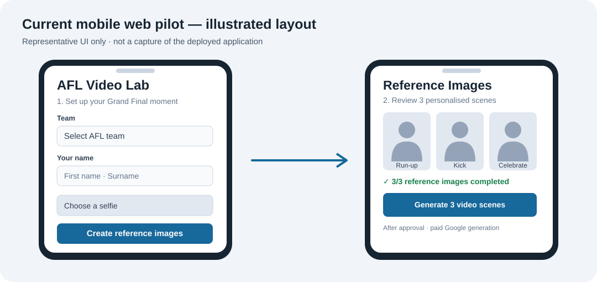
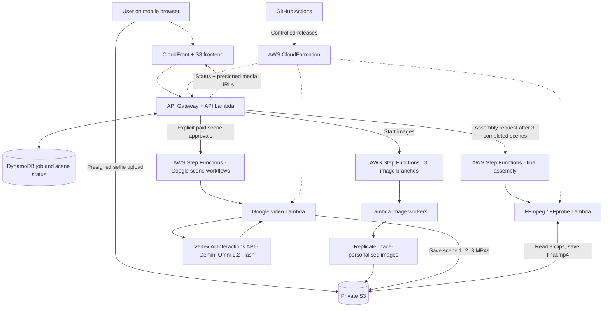

# AFL Video Platform

**Turn a selfie into an AFL Grand Final winning-goal video.**

An AWS serverless video-generation pilot. A user uploads their selfie, chooses an AFL team and enters their name. The system creates **three personalised reference images**, generates **three cinematic video scenes** with spoken commentary, and is designed to join them into one shareable MP4.

> **Current state — 11 November 2026:** Working developer pilot, **not a launched paid product**. Replicate reference-image generation and Google scene generation have been demonstrated. The FFmpeg assembly worker, orchestration, API and final-download UI are in the repository, and a user-provided mobile screenshot shows **a 17-second final stitched MP4 ready for playback/download**. That is visual evidence of one successful assembly; no independent live AWS verification was performed in this documentation update. Payments and customer authentication are not implemented. The Google worker's CloudFormation reconciliation was successfully deployed on 10 November; no further Google deployment is required for documentation changes.

## What the customer experiences

1. **Choose a team and upload a selfie.** Provide first and last name for the personalised commentary.
2. **Create three reference images.** Replicate composites the user's likeness with the run-up, winning-kick and celebration scene designs. Each reference image has its own status.
3. **Generate three videos.** Following explicit paid-generation confirmation in the developer pilot, Google Gemini Omni 1.2 Flash converts each reference image and its scene prompt into a short MP4. The scenes can run concurrently; the UI shows their independent progress and failures.
4. **Stitch and download.** The implemented FFmpeg assembly path is intended to normalise and join the three saved MP4s into one final video and expose a signed download link. A supplied mobile screenshot shows a completed 17-second final MP4 with a download button; independent backend verification remains outstanding.

| Scene | Story | Commentary (example) |
| --- | --- | --- |
| 1 — Breakaway | Player runs towards the camera | “{Surname} breaks free! 10 seconds left.” |
| 2 — Winning kick | Player kicks through the goalposts | “He kicks… IT'S A GOAL!” |
| 3 — Celebration | Teammates celebrate the premiership | “{First name} {Surname} has won the premiership for {Team}.” |

Durations are configurable in versioned scenario assets; do not rely on older documentation for live duration values. The current test UI displays 5 / 8 / 10 seconds.

## Mobile web pilot

**No Amazon Cognito is used in the current application.** API Gateway uses an `x-api-key` for developer testing; consumer authentication is not yet built.

Three real mobile screenshots supplied for this documentation update show (1) team/name/selfie input, (2) three completed personalised reference-image cards and (3) a final 17-second MP4 player with its download button. These are stronger evidence of the actual user journey than the illustration below. **The screenshot binaries are not yet committed to this repository**, so the existing illustration is retained until they can be uploaded without broken image links.

The existing interface is a **mobile-friendly developer test application**, not the proposed commercial checkout. It supports selfie upload, three reference images, generation status, diagnostics, video playback and an implemented final-download control.

*Illustration, **not screenshots** of the deployed interface. Real phone captures can replace this graphic after a representative successful end-to-end run. The current app also includes developer-only API key and troubleshooting controls.*

## How it works — AWS architecture

The three processing paths are **separate**: Replicate generates reference images; Google's model generates videos; **FFmpeg stitches existing MP4s without calling either paid model**. Job status and idempotency live in DynamoDB. Private video media is transferred using presigned S3 URLs, rather than through API Gateway.

For a standalone diagram, see [the existing architecture graphic](docs/architecture-high-level.svg).

## Implementation status

| Capability | Current status |
| --- | --- |
| Selfie upload and job creation | Implemented with presigned S3 POST and DynamoDB |
| Three personalised reference images | Implemented; previous pilot succeeded |
| Three Google-generated MP4s | Implemented; previous pilot succeeded, but individual submissions can fail |
| Asynchronous polling and failure diagnostics | Implemented, with further recovery improvements needed |
| Per-scene idempotency / duplicate-paid-request protection | Implemented; ambiguous paid submissions are **not automatically retried** |
| FFmpeg stitching and assembly API | Implemented; supplied screenshot shows one finished 17-second video; live AWS configuration not independently inspected |
| Final MP4 playback and timestamped filename download | Implemented; mobile screenshot shows final video ready and download control; download transfer not independently verified |
| Payments, consumer sign-in and entitlements | Not implemented |
| Production rate limits, provider costs, abuse prevention | Additional work required |

### Known engineering considerations

- **Google person/celebrity safety filtering:** Some recognisable-person test images have been rejected. Replicate success does not guarantee acceptance by Google.
- **Quota/rate limits:** Distinct from content-policy failures; failed scenes should not be silently recharged or regenerated.
- **Assembly activation:** The backend CloudFormation template has an `AssemblyEnabled` parameter whose default is `false`. Verify the **live stack parameter**, not just the template, before declaring assembly available.
- **Cost:** Google video seconds are billable. No paid Google requests are needed for ordinary repository checks, documentation work or assembly tests using already existing completed clips.
- **Deployment:** `.github/workflows/release.yml` controls baseline, preview and explicitly approved backend releases. **A normal push does not deploy every stack.** The one-time Google reconciliation is completed; don't repeat it.

## Repository map

| Path | Responsibility |
| --- | --- |
| `frontend/` | Current mobile-friendly HTML/CSS/JavaScript developer pilot |
| `src/api/handler.py` | API routes, jobs, approvals, polling, assembly request, signed URLs |
| `src/image_worker/` | Replicate reference image generation |
| `src/google_video_worker/` | Asynchronous Google submission, polling, diagnostics, MP4 storage |
| `src/assembly_worker/` | FFprobe validation, FFmpeg normalisation and concatenation |
| `scenarios/afl-grand-final-winning-kick/v1/` | Versioned scene images, prompts and configuration |
| `infrastructure/app/` | CloudFormation backend, Google, assembly and frontend templates |
| `.github/workflows/` | CI, controlled releases, audits and diagnostics |
| `tests/` | Python and browser test suites |

## Engineering documentation

- [Architecture and service responsibilities](docs/ARCHITECTURE.md) — note its 8 November status text predates the assembly implementation
- [API endpoints](docs/API_ENDPOINTS.md)
- [Scenario prompts](docs/VIDEO_PROMPTS.md)
- [Code review and known risks](docs/CODE_REVIEW_2026-11-08.md) — historical snapshot; some work is already implemented
- [Deployment ownership and release process](docs/DEPLOYMENT_OWNERSHIP_AUDIT.md) — historical 10 November planning snapshot; Google reconciliation was completed later that day
- [GitHub release workflow](.github/workflows/release.yml)

**Security note:** The pilot's `x-api-key` is a development/testing mechanism, **not consumer authentication**. User ownership, payment entitlement checks, and privacy/retention rules are required before a public launch.
