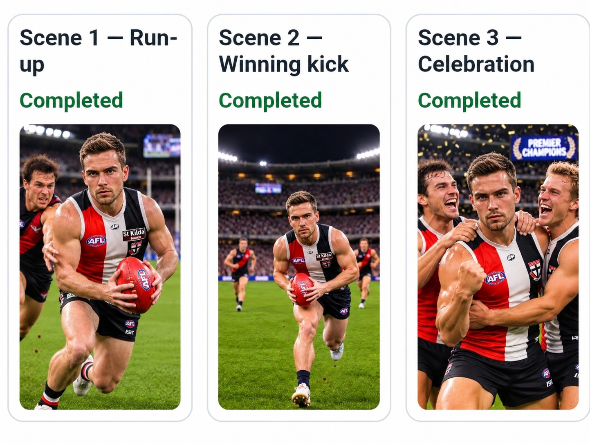
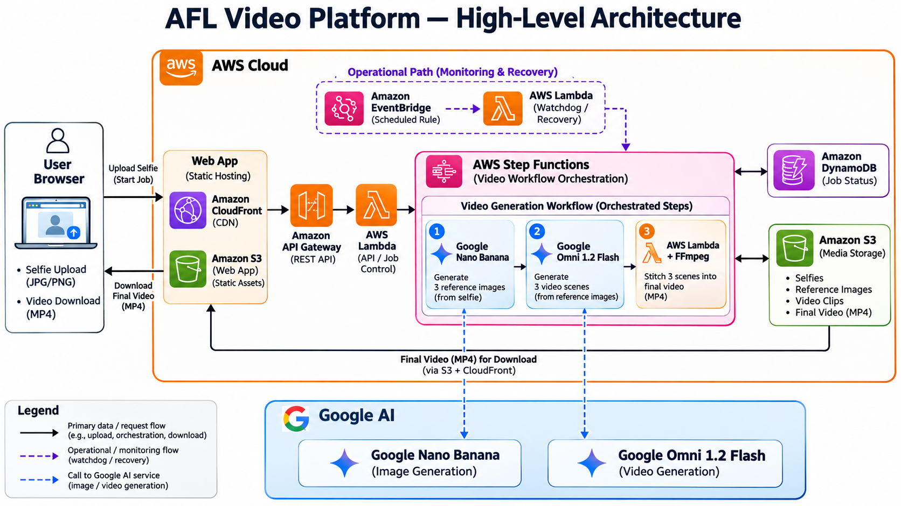

# AFL Video Platform

**Turn a selfie into your own AI-generated AFL Grand Final highlight.**

A mobile-friendly web app that puts you into personalised football scenes. Choose your AFL team, upload a selfie and enter your name to create AI-generated action, celebration and commentary featuring you.

## How it works

1. **Choose your team and upload a selfie.** Enter your first and last name.
2. **Create reference images.** AI places you into three football moments, wearing your team's colours.
3. **Generate video scenes.** Animate the images into a run-up, a winning kick and a premiership celebration, with personalised commentary.
4. **Watch your highlights.** Preview the generated scenes and play your MP4 videos.

## Screenshots

| Selfie and team | AI-generated reference scenes | Video preview |
| --- | --- | --- |
|  |  |  |

## Architecture

The platform runs on **AWS** and integrates with **Google Cloud** for AI video generation. **Amazon CloudFront and S3** host the web app and store images and videos; **API Gateway and Lambda** provide the backend; **AWS Step Functions** coordinates processing; and **DynamoDB** tracks each job. The current reference-image worker uses a **direct Google Vertex image-generation adapter**, while **Google Vertex AI's Interactions API** uses **Gemini Omni 1.2 Flash** to generate the football video scenes. Historical Replicate integration notes remain in dated development documents. **Google Cloud Workload Identity Federation** enables the AWS video worker to authenticate securely to Google Cloud.

[**Architecture overview**](docs/ARCHITECTURE.md) · [**Architecture diagram**](docs/architecture-high-level.svg)

## Technical documentation

**Start at the [documentation index](docs/README.md)** for authoritative current contracts versus historical release plans.

- [Current AWS architecture](docs/ARCHITECTURE.md)
- [Complete HTTP API contract — 20 routes](docs/API_ENDPOINTS.md)
- [Job statuses and terminal outcomes](docs/JOB_STATUSES.md)
- [Retry, timeout and error-handling contract](docs/RETRIES_AND_TIMEOUTS.md)
- [AWS infrastructure inventory](docs/INFRASTRUCTURE.md)
- [Resilience audit and open gaps](docs/RESILIENCE_AUDIT_2026-11-16.md)
- [Documentation-to-code quality review](docs/DOCUMENTATION_QUALITY_REVIEW_2026-11-16.md)
- [GitHub Actions release workflow](.github/workflows/release.yml)

**Operational limitation:** The application is in developer/testing mode. Secure no-signup customer recovery, Stripe payment validation/refunds and complete live fault-injection coverage are not implemented. Old stage/deployment documents are historical and should not be followed as current instructions.

---
**AFL Video Platform** · Personalised AI-generated football highlights.
