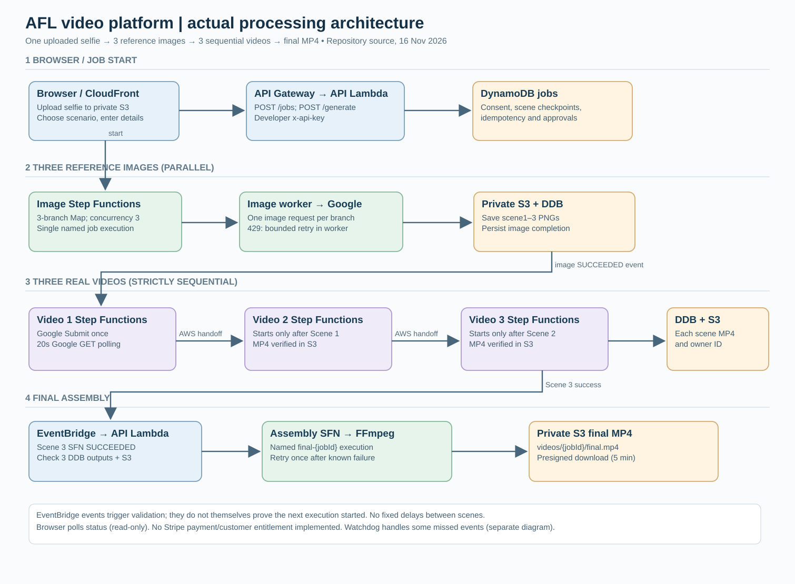

# AFL video platform — current architecture (8 November 2026)

This page describes **implemented code**, not the earlier stage plans. AWS Sydney (`ap-southeast-2`), development environment.

## High-level architecture diagram

[Open the diagram on its own](architecture-high-level.svg). The image and paid-video pipelines are intentionally separate; both use the same API, job table and private storage. The arrows show the main processing sequence, not every individual read/write call.

## What exists

The test website is a replaceable **HTML/JavaScript client**, hosted in private S3 via CloudFront. The business workflow is behind **API Gateway REST API** and an API Lambda. AWS resources are deployed with **CloudFormation and GitHub Actions** (not Terraform).

**Flow — no diagram required:**

1. Browser calls API for an S3 presigned upload form. Browser sends selfie **directly to S3**, then calls API to create a DynamoDB job.
2. User explicitly starts image generation through API. Step Functions starts three parallel image-worker branches (`MaxConcurrency=3`). The worker uses versioned S3 master images and the job's selfie, calls **Replicate/Nano Banana Pro**, and saves three edited reference images to private S3.
3. Browser polls API for job and image statuses and loads generated images from **short-lived S3 signed URLs**.
4. Browser requests each personalised, versioned video prompt through API; API renders S3 templates with validated name, team, guernsey and commentary variables. Preview is free.
5. User explicitly approves and starts **one of the three paid scenes** via API. API conditionally reserves that job/scene in DynamoDB, then starts the **Google paid-video Step Functions workflow**.
6. Google video worker checks approval, reads matching S3 reference image and rendered prompt, requests the **Google Vertex Interactions API** model `gemini-omni-1.2-flash`, and polls its interaction. Scene 1 = 8 seconds, Scene 2 = 8 seconds, Scene 3 = 10 seconds.
7. Worker writes completed MP4s to private S3 at `videos/{jobId}/sceneN.mp4`, and records progress in DynamoDB. Browser reads statuses through API and plays/downloads via **presigned S3 GET URLs**.

**Implemented and tested in pilot:** three reference images and all three separately generated real MP4 clips. **Not implemented:** combining MP4s into one final clip, consumer sign-in, payments, product order/entitlements, consumer-scale operational controls. An existing mock-only video workflow is separate from the real Google workflow.

## Key responsibilities

| Part | Responsibility | Reusable by replacement app? |
|---|---|---|
| CloudFront and `frontend/index.html` | Test page, browser interactions and polling | **Replaceable** |
| API Gateway and `src/api/handler.py` | Public route contract, job lifecycle, paid submission, status, presigned links | **Yes** — primary backend boundary |
| DynamoDB job table | Per-job image/video state, paid approval, idempotency | Yes |
| Step Functions + image worker | Three reference images, parallel Replicate jobs | Yes |
| Step Functions + Google video worker | Paid per-scene generation, polling, MP4 storage | Yes |
| Private S3 buckets | Selfies, scene masters, prompts, output images, MP4s | Yes |
| Secrets Manager / AWS-to-Google WIF | Provider credentials | Yes |
| GitHub Actions + CloudFormation | CI/CD and infrastructure | Yes, though multiple stage-era workflows should be consolidated later |

## Does the browser use the API for everything?

**For application commands and status, essentially yes.** The current website uses the REST API to list scenarios, get upload permissions, create a job, start images, fetch job/images/videos, preview prompts, check Google auth and submit paid scene requests. The user-supplied `x-api-key` is a **developer test key only**, not consumer authentication.

There are two appropriate direct-to-S3 exceptions: **selfie upload** using a presigned POST and **media display/download** using temporary signed GET URLs. They still require API-issued permission; media bytes do not pass through the API Lambda. Replacing the website with React, Flutter, mobile apps or another client can reuse this architecture, but consumer authentication and payment authorisation must be added at the API boundary.

## API reference and review

- [Current complete HTTP endpoint inventory](API_ENDPOINTS.md)
- [Prioritised code risks and recommended next fixes](CODE_REVIEW_2026-11-08.md)
- [Versioned audio/video prompts](VIDEO_PROMPTS.md)

Older stage-design documents are historical and may mention future work that is **already implemented**. This page and the endpoint inventory are the current overview.
