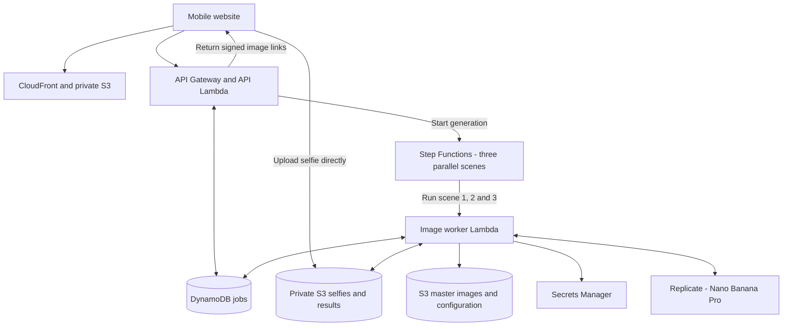
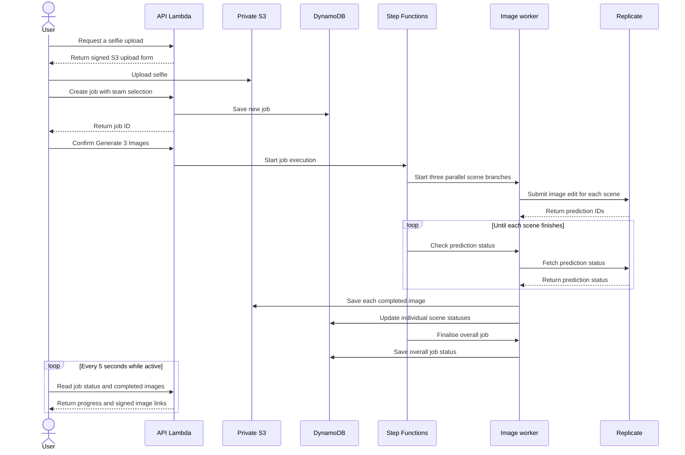
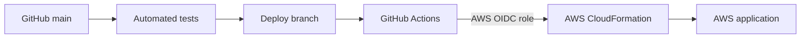

# AFL Video Platform — Architecture

**Status:** Working image-generation prototype (November 2026)  
**Environment:** AWS Sydney (`ap-southeast-2`), `dev`  
**Website:** https://d9i3mlqvt0ks6.cloudfront.net

> **What works today:** A user chooses an AFL team, uploads a selfie, and generates three personalised still images. Each image is tracked separately and displayed on the phone as soon as it finishes. **Video generation is the next phase, not yet built.**

## 1. Architecture at a glance

The website is served by **CloudFront** from private **S3**. The **API Lambda** creates jobs, verifies uploads and starts generation. **Step Functions** coordinates three branches. The **image worker Lambda** calls Replicate and writes the results to private S3. **DynamoDB** stores each job's progress.

## 2. What happens when someone generates images?

The diagram focuses on the main steps. The three branches run concurrently using a Step Functions **Map state with maximum concurrency 3**. Each scene has its own submit, wait, poll and save actions.

### The three scenes

| Scene | Personalisation |
|---|---|
| **1. Build-up** | Selfie face and selected-team guernsey on the player running with the ball |
| **2. Approach to kick** | Selfie face and selected-team guernsey on the player preparing to kick |
| **3. Celebration** | Selfie face on the main player and matching team guernseys on teammates |

The three source images are stored under `scenarios/afl-grand-final-winning-kick/v1/` in the private, versioned artifact bucket. The team's guernsey descriptions and editing instructions are in [scenario configuration](../scenarios/afl-grand-final-winning-kick/v1/config.json).

Scene 2 is intentionally a **starting position**. The actual kick will be animated later.

## 3. How jobs are tracked

Each job is a DynamoDB item with an overall status and three independently tracked scenes.

| Overall job status | Meaning |
|---|---|
| `AWAITING_IMAGE_PIPELINE` | Selfie uploaded, waiting for Generate |
| `GENERATING_IMAGES` | One or more scene branches are running |
| `COMPLETED` | All three images succeeded |
| `PARTIAL_SUCCESS` | Some images succeeded, some failed |
| `FAILED` | No images succeeded or setup failed |

Each scene moves through `PENDING`, `SUBMITTING`, `GENERATING` and `COMPLETED` or `FAILED`. We save its Replicate prediction ID, S3 result key and a safe failure code where applicable.

The phone polls the existing API **every five seconds**, shows each finished thumbnail without reloading it, pauses polling when the tab is hidden and stops at a terminal status. Polling does **not** create extra image-generation requests.

### Failure handling

- Generation is **explicitly confirmed** before up to three paid Replicate predictions begin. Uploading a selfie does not trigger Replicate.
- Conditional DynamoDB updates and a named Step Functions execution help prevent duplicate requests for the same job.
- Confirmed Replicate **HTTP 429** rejections can be retried up to **six total attempts**, respecting `Retry-After` or using exponential backoff and jitter (adapted from SkyGrid).
- An uncertain submission, such as a network timeout, is **not automatically resubmitted** because it may already have been accepted and charged.
- One scene can fail without losing the completed images from the other scenes.
- An **EventBridge** rule checks every five minutes for jobs stuck beyond 45 minutes and marks them terminal without launching new predictions.

## 4. AWS components

| Service | Purpose |
|---|---|
| **CloudFront + private S3** | Host the mobile test website |
| **API Gateway REST API** | Route `/dev` requests with a development API key |
| **API Lambda** | Selfie upload links, jobs, status and signed result links |
| **S3 uploads/results bucket** | Store customer selfies and generated PNGs |
| **DynamoDB** | Job status and per-scene state |
| **Step Functions Standard** | Run and coordinate three parallel scene jobs |
| **Image worker Lambda** | Replicate submit, poll, save, failure handling and recovery |
| **S3 artifact bucket** | Versioned master images, scenario config and deployment ZIPs |
| **Secrets Manager** | Replicate API token |
| **EventBridge** | Recover abandoned jobs |
| **CloudWatch Logs** | API and worker troubleshooting |
| **GitHub Actions + CloudFormation** | Validate and deploy the platform |

**Region:** `ap-southeast-2` (Sydney). The deployed Step Functions resource retains its historical name `afl-app-dev-scene1-pilot`, despite now running three scenes.

**Developer API:**
`https://ue36acwvrc.execute-api.ap-southeast-2.amazonaws.com/dev`

| Method | Endpoint |
|---|---|
| GET | `/scenarios` |
| POST | `/uploads` |
| POST | `/jobs` |
| POST | `/jobs/{jobId}/generate` |
| GET | `/jobs/{jobId}` |
| GET | `/jobs/{jobId}/images` |

Uploaded selfies and generated outputs currently expire from S3 after **seven days**. Completed image links are short-lived, signed URLs.

## 5. How we deploy

The one-time bootstrap creates deployment roles, a permissions boundary and the private artifact bucket. GitHub Actions uses **OIDC** to assume the AWS deployment role. **CloudFormation**, not Terraform, manages application infrastructure.

Core source files: [frontend](../frontend/index.html), [API Lambda](../src/api/handler.py), [image worker](../src/image_worker/handler.py), [frontend stack](../infrastructure/app/frontend.yaml), [backend stack](../infrastructure/app/backend.yaml), [deploy workflow](../.github/workflows/deploy.yml).

## 6. Next phase — not implemented yet

**Google Veo video generation** will animate the three personalised still-image starting frames. We will design the scene prompts, clip generation, commentary/audio, video stitching and final playback separately. There is currently **no Veo integration, video stitching, payment system or customer account login**.

**Before a consumer launch**, we also need proper authentication, payments, monitoring/alerts, cost controls, data/privacy policies and more robust reconciliation of uncertain provider submissions.

---

**Scope:** This page describes the working prototype. For detailed implementation notes, see [parallel-scene processing](PARALLEL_SCENES.md). Update this document when the architecture changes.
