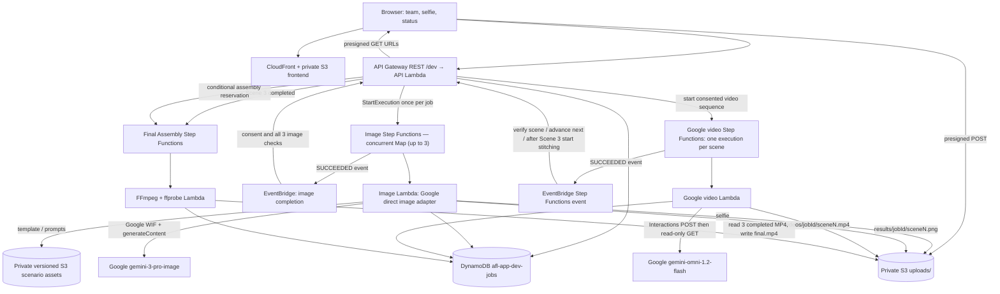

# AFL Video Platform — Current Architecture

> **16 NOVEMBER 2026 RESILIENCE RE-AUDIT:** The backend-driven sequence and conditional reservations are valuable, but the current projection of `assembly.FAILED` is **prematurely terminal** while the assembly Step Functions may retry once after 15s. Source also shows an EventBridge-started per-job watchdog with a 7200s cap and no guaranteed missed-start coverage, and retention policies for uploads/results but not videos. Read [RESILIENCE_AUDIT_2026-11-16.md](RESILIENCE_AUDIT_2026-11-16.md) (RA-01…RA-12) as the authoritative current gap register. This audit updated docs only, not AWS services.
>

**Audit:** 15 November 2026 (post stages 1–3) | **Source:** `main` repository | **Confidence:** SOURCE VERIFIED; guarded AWS release logs verify API, EventBridge rules and frontend assets; full unattended real-job run and independent infrastructure drift scan remain outstanding.

**Source of truth:** `src/api/handler.py`, `src/image_worker/{handler.py,google_direct.py}`, `src/google_video_worker/handler.py`, `src/assembly_worker/handler.py`, `frontend/{index.html,app.js}`, `infrastructure/app/{backend,google-video,assembly,frontend}.yaml`.

> This document describes the **currently implemented source**, not historical plans. Payment and refunds are **not implemented**. Existing references to "paid" mean Google model calls that incur provider cost, **not Stripe authorisation**.

## Architecture and flow

The diagram is a logical model. After browser upload, job creation and the single `POST /jobs/{jobId}/generate`, **AWS owns the image-completion → Video 1 → Video 2 → Video 3 → final assembly progression**. API Lambda receives EventBridge successful-execution events, verifies prior durable state and conditionally reserves the next step. Browser progress GETs do not submit videos or stitching. Diagram does not represent retries, IAM boundaries or all infrastructure.

### 1. Upload / job creation

1. Browser calls `POST /uploads` for regional SigV4 S3 presigned POST. Accepts JPEG/PNG/WebP, 1–10MiB, expires 300s.
2. Browser sends selfie directly to private S3 `uploads/{uuid}.{ext}`.
3. Browser calls `POST /jobs` with `uploadKey`, scenario/team/names, `confirmPaidSequence: true`, and `Idempotency-Key`; API HEAD-checks file, validates input, conditionally creates `afl-app-dev-jobs` record with `AWAITING_IMAGE_PIPELINE`, `autoVideoConsent: true` and default seven-day TTL. This is developer-mode permission for Google-cost video calls, **not Stripe payment verification**.
4. **Current frontend immediately starts reference images after job creation**. This is a critical requirement to change *later* when Stripe is introduced: no chargeable model calls before verified payment.

### 2. Reference images

`POST /jobs/{jobId}/generate` starts named STANDARD Step Functions execution `jobId`. Source image workflow `afl-app-dev-scene1-pilot` (historical name) has `Prepare → ParallelScenes [Map MaxConcurrency:3] → Finalize`, with Catch to `RecoverJob`. All three image branches can run concurrently **within a job**, with independent per-scene 429 retry waits; this is not an account-wide Google/API concurrency limit.

For each scene, image worker reads job/selfie and versioned team template/prompt from S3, authenticates using AWS→Google Workload Identity Federation (WIF), and POSTs directly to Vertex `gemini-3-pro-image:generateContent`. Google responds synchronously with image content; worker validates/converts to PNG and writes `results/{jobId}/sceneN.png`, then persists per-scene `COMPLETED`.

Only an explicit HTTP 429 rejection allows automatic new image model submission: up to eight attempts total within 600s retry window, with bounded exponential delay/jitter and respect for Retry-After. Ambiguous POST timeouts are *not* automatically retried. Failed image map iteration is marked failed and Map can progress to another scene; no automatic resume of failed image from checkpoint exists.

Current image master mapping in `src/image_worker/handler.py` chooses the masked `sceneN-start-masked.png` master only for Collingwood scenes 1 and 3; other team/scene combinations use `sceneN-start.png`. Do not generalise masked templates to all teams without checking actual code/assets.

### 3. Real video scenes

After the image Step Functions execution SUCCEEDS and all three reference images are durable, the **image-completion EventBridge rule** invokes API Lambda `image_sequence_event()`. It requires the job's previously stored `autoVideoConsent: true`, exact named image-workflow execution, image job `COMPLETED` and all three scene records `COMPLETED`, then internally reuses `start_video_sequence()`. The legacy public `POST /jobs/{jobId}/real-videos/sequence` remains available for guarded developer/manual use, but the current browser no longer calls it. The sequence approval is conditional and reserves the first missing scene. First missing original scene starts via `POST .../real-videos/{scene}` internal handler using stable execution name `real-{jobId}-sceneN`. API refuses starting scene 2 before scene 1, or scene 3 before scene 2, without a durable completed prior MP4.

Video STANDARD Step Functions `afl-app-dev-google-omni`: `PaidGate → Claim → SubmissionSchedule → Submit → WaitForVideo (20s) → PollVideo → InspectVideo`, looping until done, then `Finalize`. Source includes 10-second scene 2 and 20-second scene 3 scheduling waits. Only **read-only PollVideo** has Step Functions retry: 3 retries (10/20/40 seconds); paid `Submit` has none.

Worker uses Google `gemini-omni-1.2-flash` on Vertex Interactions v1beta1, POST `.../interactions` followed by GET `.../interactions/{interactionId}`. It records `SUBMISSION_UNKNOWN` *before* paid POST, so lost acknowledgements cannot safely trigger another submission. On accepted response, stores `interactionId` and `PROCESSING`, polls, validates completed MP4 (inline or private Google Cloud Storage output if configured), writes `videos/{jobId}/sceneN.mp4` and persists `COMPLETED`.

Successful Step Functions execution emits an EventBridge status-change event to API Lambda's `video_sequence_event()`. This verifies original/stored scene status and S3 object then starts the next missing scene, with conditional DDB guards against duplicate events. Failures can stop advancement and require scene-specific manual retry (max **10 total attempts**, only confirmed terminal provider failure and safe completed previous workflow). **This is not yet automatic customer recovery.**

### 4. Final assembly and customer delivery

All three real MP4 scene keys must exist and be marked `COMPLETED`. The existing **video-completion EventBridge rule** sends Scene 3 successful execution to API `video_sequence_event()`, which verifies the current scene attempt, the completed scene-3 MP4 and its S3 object, and calls `start_assembly()`. That existing function verifies all three completed MP4s exist, conditionally persists `assembly:QUEUED`, and starts named `final-{jobId}` assembly execution. Duplicate events cannot create a second assembly. The browser does not initiate stitching; **lost AWS handoffs and failed/stalled assembly still require a recovery solution**.

FFmpeg Lambda downloads three MP4s, probes each, normalises to 720×1280/30fps with H.264/AAC, concat-copies final MP4, uploads `videos/{jobId}/final.mp4`, HEAD-verifies and writes `assembly:COMPLETED`. Assembly has no Step Functions Retry/Catch; input clips are retained on S3 failures. Frontend stitching percentage is a **visual-only ten-second estimate**, not a measured FFmpeg percentage. Final download filename is `afl-grand-final.mp4`, via 300-second signed S3 URL.

## Status and diagnostics boundaries

An **implemented read-only end-to-end status projection** exists: `GET /jobs/{jobId}` includes `job.progress` with `currentStage`, `stageStatus`, image/video completion counts and `finalVideoReady`, derived from existing persisted image/video/assembly records. Legacy `job.status` remains the **image job status**, not a renamed global status. `GET /jobs/{jobId}/videos` reports per-scene progress plus assembly, and `GET /jobs/{jobId}/assembly` reports the final result. Video IDs and failure/retry metadata remain available to developer diagnostics. Normal frontend image/video polling is five seconds (fifteen on error); the **overall status line** polls every two seconds while its developer diagnostics panel is expanded and visible. Neither polling path submits paid video or stitching.

See [JOB_STATUSES.md](JOB_STATUSES.md) and [API_ENDPOINTS.md](API_ENDPOINTS.md) for exact response shapes and statuses. Do **not** expose provider diagnostics, keys or media outside authorised customer access after payments.

## Infrastructure and operations

- AWS region: source configured `ap-southeast-2`. CloudFormation stacks include `afl-app-dev-backend`, `afl-app-dev-google-video`, `afl-app-dev-assembly`, `afl-app-dev-frontend`, and a separate legacy `afl-app-dev-video`; bootstrap stack manages shared artifacts/deploy foundation.
- Jobs and media remain in private S3/DynamoDB; frontend is public HTTPS CloudFront backed by private S3 via OAC.
- Application deploy via GitHub Actions OIDC, CloudFormation and source/release scripts. `.github/workflows/release.yml` contains controlled changeset preview and separately gated backend deployment, plus historical one-shot jobs; don't assume a source commit automatically deployed.
- Logs in CloudWatch, explicit 14-day Lambda log group retention in source; image watchdog EventBridge `rate(5 minutes)` terminalises stalled image jobs older than 45 minutes without new Google POSTs.
- API Gateway developer `x-api-key` gates pilot routes; no per-customer authentication/entitlements, Stripe or refund records exist.

Full inventory: [INFRASTRUCTURE.md](INFRASTRUCTURE.md). Retry matrix: [RETRIES_AND_TIMEOUTS.md](RETRIES_AND_TIMEOUTS.md). Source/deployment evidence limitations: [DEPLOYMENT_BASELINE_2026-11-15.md](DEPLOYMENT_BASELINE_2026-11-15.md).

## Known gaps before charging consumers

1. No payment verification before current automated image generation.
2. No secure anonymous order/job recovery on browser reload.
3. The read-only `job.progress` projection is implemented and deployed; a persisted unified global state/event log is **not** implemented. Preserve existing compatibility.
4. Ambiguous Google responses/unknown operations can require manual reconciliation.
5. Video scene retry requires developer/user action, not bounded automatic consumer recovery.
6. Final assembly **is backend-triggered** after Scene 3 success; assembly workflow still has no automatic recovery/retry or lost-handoff reconciliation.
7. Seven-day upload/results/job TTL is not coordinated with paying customer support/refund retention; `videos/` lifecycle requires review.
8. Developer API key not customer authorisation; API status must be guarded per job.
9. Some historical API messages still mention Replicate; `parallelScenes:true` now correctly reflects the image Map concurrency but should not be interpreted as unrestricted provider throughput.
10. Configured AWS values must be checked against active live resources before production sign-off.

**Documentation revision only:** no prompts, model calls, code, AWS infrastructure or payment logic were modified while updating this file. Backend handoffs were separately deployed in [Stage 1](https://github.com/rorygleeson/afl-video-platform/actions/runs/43689396745), [Stage 2](https://github.com/rorygleeson/afl-video-platform/actions/runs/43689754297) and [Stage 3](https://github.com/rorygleeson/afl-video-platform/actions/runs/43690121205). No new full paid end-to-end run was made as part of this document review.

## Event-driven handoff watchdog (source review: 2026-11-16)

The **isolated** `afl-app-dev-handoff-watchdog` stack monitors **one explicitly consented job at a time**. Image Step Functions `RUNNING` emits an EventBridge event to the watchdog Lambda; the Lambda validates the job and starts uniquely named Standard Step Functions `watch-{jobId}`. A selfie upload alone does not start it. The watchdog state machine then **waits 60 seconds** between Lambda checks (the currently reviewed source is **not** configured for 2 minutes). There is no idle watchdog cron and no DynamoDB Scan. It has a 7,200-second (2-hour) maximum life and exits for completed assembly or terminal failure/review cases.

This is a **missed-success-handoff reconciler**, not a universal stuck-stage timeout manager. The **120-second** `MIN_AGE_SECONDS` constant is the *minimum age since a verified successful execution stopped* before replaying a potentially lost success event to the existing API. It is **not** the check interval or a two-minute timeout for an in-flight Google operation. `DescribeExecution` must report `SUCCEEDED`; the watchdog must not resubmit a provider request, write a job record, restart a running scene, or bypass existing API reservations. `SUBMISSION_UNKNOWN` is left in monitoring/review, never automatically paid again. An assembly already reserved is observed, not retriggered.

**Separate legacy system:** `afl-app-dev-reconcile-images` still has a **5-minute** schedule and can terminalise stalled image jobs after approximately 45 minutes. Unlike this isolated watchdog, that scheduled image reconciliation can run when no user jobs are active. Do not combine the two in cost/timeout claims.

**Limitations before customer rollout:** an image `RUNNING` EventBridge event can be lost (no per-job watchdog then); the 2-hour watchdog deadline is not per-stage timeout enforcement; a reserved/unknown assembly is not automatically recovered; and no end-to-end provider run or fault injection was performed during this documentation review. Source checked: `src/handoff_watchdog/handler.py`, `infrastructure/app/handoff-watchdog.yaml`, `tests/test_handoff_watchdog.py`. Previous guarded AWS deployment verification is recorded in [RESILIENCY_ROADMAP.md](RESILIENCY_ROADMAP.md); this review did **not** re-read live CloudFormation resources.

See [the focused watchdog architecture diagram](watchdog-architecture.svg).

## Browser refresh recovery (frontend-only, 2026-11-16)

The developer UI remembers a **validated current job ID** in same-origin `localStorage` under `afl-video-active-job-v1` as soon as `POST /jobs` confirms its job. After refresh/reopen it uses **GET /jobs/{jobId}**, **GET /jobs/{jobId}/images** and **GET /jobs/{jobId}/videos** to rebuild the existing scene cards, progress, manual retry eligibility and final video. The restore path performs **no POST**, no new image generation, no billable Google request and no assembly start. A visible **Start new video** button explicitly clears the local job pointer; it does not delete the old AWS job.

The existing developer API key is kept **only in sessionStorage**, not localStorage. The app may request it again after a browser session ends; a failed key/network read keeps the pointer for later safe retry. Selfie bytes, signed media URLs and greeting text are **not stored in localStorage**. The API job projection returns name, team, scenario **and the previously saved personal message**; the restored message and its 80-character counter are read from AWS and displayed in a locked field. Neither the message nor the selfie is stored in localStorage. Resume works only while AWS job/media retention permits. This is a convenience mechanism **not suitable as customer authorisation**: future Stripe/anonymous recovery needs a server-validated, expiring per-job capability token. Uploads with uncertain job-creation response still require manual support because there is no confirmed job ID to persist.

Automated frontend regression tests cover no duplicate paid POSTs, resume and explicit new-job clearing. Browser testing with a real AWS job remains pending.

## Resumed-job UI controls and selfie preview (2026-11-16)

- **Start new video** is **hidden** during image processing, scene-video generation and FFmpeg stitching. Visibility comes from the existing GET job `progress` projection and the read-only video/assembly snapshot, not the legacy image-only `job.status`. The UI offers a new start after a verified final MP4, terminal image failure, a video failure with all manual attempts exhausted, or terminal assembly failure. Unknown states and failed scenes that can be retried do **not** expose it. Button clicks also check the current hidden state; this does not modify backend execution.
- **Resumed selfie preview** uses a new read-only `GET /jobs/{jobId}/selfie`, which validates the persisted `uploads/<uuid>.<ext>` key and signs a **300-second S3 GET** using the existing API role's `uploads/*` access. The private selfie stays in S3; neither the object key nor file bytes are saved in localStorage. If the preview cannot be fetched, the job continues, and the page reports preview unavailability rather than recreating the upload.
- After confirmed job restoration, the original browser file input **and its label** are hidden. The previously uploaded photo is displayed from the signed URL, and the input stays locked to prevent accidental changes.
- The new read-only endpoint is a developer-mode route guarded by the existing API Gateway key. This is **not** a production customer capability token; future public/Stripe release needs authenticated, per-order expiring access. Signed preview expires after five minutes; a loaded image normally remains rendered, and refreshing requests a new one while the object is retained.
- Source changes touch `src/api/handler.py`, `frontend/index.html`, `frontend/app.js`, regression tests and a guarded API-and-frontend deployment workflow. No image/video models, prompts, watchdog, Step Functions or provider POST logic are changed.

## Backend-owned universal job ending (16 November 2026)

The authoritative stage checkpoints are still stored in the job's existing
DynamoDB image `status`/scenes, `videoSequence`/realVideos/approvals and
`assembly` map. The API's common read-only projection
`overall_job_progress(job)` returns `terminal`, `outcome`,
`currentStage` and `stageStatus`. It now recognises four terminal failure
reasons: `REFERENCE_IMAGES_FAILED`, `CONTENT_BLOCKED`,
`VIDEO_ATTEMPTS_EXHAUSTED` and `STITCHING_FAILED`. Verified final assembly
returns `COMPLETED`. `GET /jobs/{jobId}` and
`GET /jobs/{jobId}/videos` expose the same status contract.

AWS EventBridge still owns progression; the browser never starts the next
scene, retransmits Google POSTs, or decides whether a failed job is terminal.
Backend starts/retries/assembly refuse definitive failures. Status GETs never
write. The frontend transitions to a clean failure explanation for
`terminal=true/outcome=FAILED` and retains the job for later recovery/audit;
`REVIEW_REQUIRED` remains nonterminal.

There is no Stripe payment gate, persisted global lifecycle table or customer
authentication change in this release. Durable underlying stage records
provide terminal evidence, but future order/refund records require independent
longer retention. This does not solve every stuck handoff or provider-unknown
reconciliation case.

## No fixed delay between sequential videos — 16 November 2026

EventBridge completion → API verifies expected S3 MP4 and DynamoDB record → atomically reserves next named Step Functions scene execution → Google worker `PaidGate → Claim → Submit`. The historical `SubmissionSchedule` Choice, `WaitScene2` (10s) and `WaitScene3` (20s) are removed. All Google scene submissions remain sequential because the next execution is initiated only after the prior completed MP4 has been verified; no retry or duplicate paid submission protections were relaxed. Normal EventBridge/Step Functions/Lambda startup latency remains. The 20s `WaitForVideo` is still the **within-scene provider polling** interval.

### Correct assembly lifecycle after first failure — 16 November 2026

`Stitch` can fail and durably mark `assembly.FAILED`. The assembly Step Functions workflow then waits 15s and attempts **one** confirmed FFmpeg-only retry. `api.assembly_failure_disposition(job)` reads the stable `final-{jobId}` execution; a running SFN maps to customer `RETRYING` nonterminal, while final FAILED is terminal only if `retryCount=1` proves a second worker failure was recorded. Missing, aborted, timed-out, inconsistent or inaccessible SFN returns nonterminal `REVIEW_REQUIRED`. This prevents a false permanent-failure screen before safe retry; no Google request or state mutation in status GET. Other resilience gaps remain documented in the audit.
