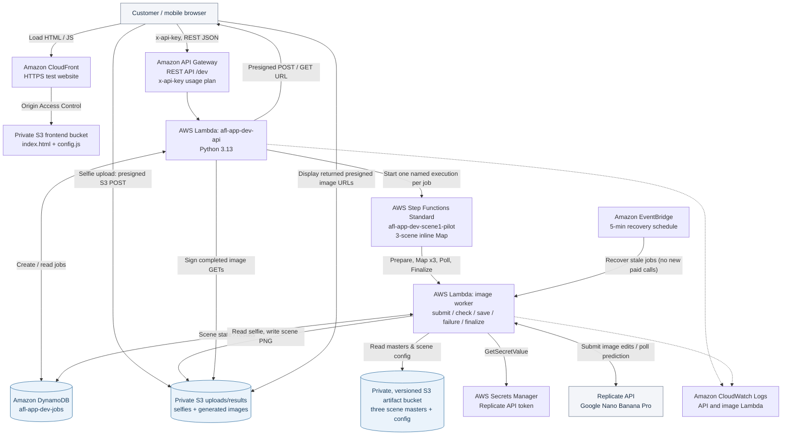
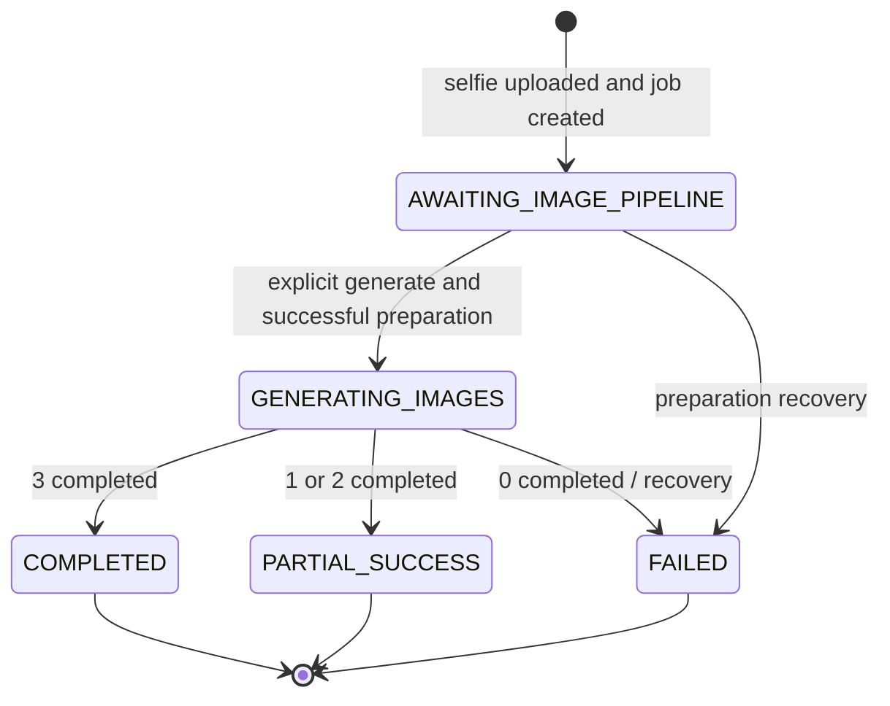
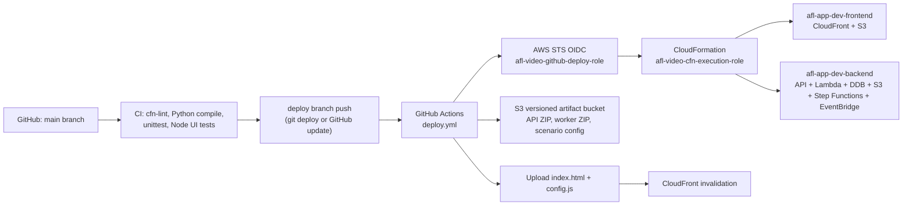

# AFL Video Platform — deployed architecture

**As of:** 7 November 2026  
**Status:** Image-personalisation proof of concept working end-to-end; **video generation is not implemented**  
**Environment:** `dev`, AWS account `134387458447`, AWS Region `ap-southeast-2` (Sydney)  
**Source of truth:** CloudFormation, Python handlers, frontend and GitHub Actions in this repository  
**Live test UI:** https://d9i3mlqvt0ks6.cloudfront.net  
**API base URL:** https://ue36acwvrc.execute-api.ap-southeast-2.amazonaws.com/dev

This is an **as-built** description, not a proposed target architecture. It is based on `infrastructure/bootstrap/bootstrap.yaml`, `infrastructure/app/{frontend,backend}.yaml`, `src/api/handler.py`, `src/image_worker/handler.py`, `frontend/index.html`, the scenario configuration and GitHub Actions workflow. The latest user-observed end-to-end test completed **3/3** personalised images with zero scene failures. That confirms the working path for one test job, not production-scale performance or identity fidelity across all inputs.

## 1. System architecture

GitHub displays the following [Mermaid](https://docs.github.com/en/get-started/writing-on-github/working-with-advanced-formatting/creating-diagrams) diagram directly.



### Component inventory

| Layer | Service / deployed resource | Responsibility |
|---|---|---|
| Frontend | CloudFront `d9i3mlqvt0ks6.cloudfront.net` | Serves the mobile-friendly test UI over HTTPS |
| Web origin | Private S3 `afl-app-dev-frontend-134387458447-ap-southeast-2` | Stores `index.html` and generated public `config.js`, accessible through CloudFront OAC |
| API | API Gateway **REST** API, `/dev` stage | Routes API requests; requires `x-api-key` for application methods and applies test usage-plan limits |
| Application | Lambda `afl-app-dev-api` (Python 3.13, 15s) | Presigned upload POSTs, job creation/status, starting orchestration, signed output image URLs |
| Job state | DynamoDB `afl-app-dev-jobs` | One item per job ID, nested per-scene state, TTL `expiresAt`, on-demand billing |
| Customer media | Private S3 `afl-app-dev-uploads-134387458447-ap-southeast-2` | `uploads/` customer selfies and `results/` scene images; each prefix expires after 7 days |
| Orchestration | Step Functions **Standard** `afl-app-dev-scene1-pilot` | Current three-scene orchestration, despite legacy `scene1-pilot` physical name |
| Image worker | Lambda `afl-app-dev-image-worker` (Python 3.13, 600s max) | Edits via Replicate, persists prediction IDs and outputs, handles errors/recovery |
| Versioned reference data | Private versioned S3 `afl-video-bootstrap-artifactbucket-xiuriidgyft4` | Immutable-by-convention master image keys, scenario config and Lambda deployment ZIPs |
| Replicate credentials | Secrets Manager `afl-app/dev/replicate-api-token` | Existing JSON secret with `REPLICATE_API_TOKEN`, accessed at runtime |
| External inference | Replicate `google/nano-banana-pro` | Two reference images (master + selfie), selected-team prompt; output 9:16 at 2K in PNG format |
| Recovery | EventBridge rule `afl-app-dev-reconcile-images` | Invokes worker every 5 minutes to detect active jobs older than 45 minutes |
| Logging | CloudWatch log groups for both Lambdas, 14-day retention | Lambda diagnostics; a Step Functions log group exists but the template **does not attach it** to the state machine with a `LoggingConfiguration` |
| Deployment | GitHub Actions, OIDC, CloudFormation | Validates, packages and deploys stacks and frontend without stored AWS access keys |

## 2. Customer request and data flow

```mermaid
sequenceDiagram
    autonumber
    actor User as Customer (browser)
    participant Web as CloudFront website
    participant API as API Gateway + API Lambda
    participant S3 as Private S3
    participant DDB as DynamoDB
    participant SFN as Step Functions
    participant Worker as Image worker Lambda
    participant Rep as Replicate API

    User->>Web: Open site; choose selfie and AFL team
    User->>API: POST /uploads (content type, bytes; x-api-key)
    API-->>User: Presigned S3 POST (5-minute expiry)
    User->>S3: Upload selfie directly with signed form
    User->>API: POST /jobs (scenario, team, S3 key; Idempotency-Key)
    API->>S3: HEAD selfie, check size and type
    API->>DDB: Conditional PutItem
    API-->>User: jobId, AWAITING_IMAGE_PIPELINE
    Note over User,Rep: Image generation is NOT invoked by uploading a selfie
    User->>API: POST /jobs/{jobId}/generate (explicit confirmation)
    API->>SFN: StartExecution (name = jobId)
    SFN->>Worker: Prepare: validate 3 masters and selfie, initialize scenes
    Worker->>DDB: GENERATING_IMAGES; 3 PENDING scenes
    par Scene 1
      SFN->>Worker: Submit scene1
      Worker->>Rep: Create image-edit prediction
      Rep-->>Worker: predictionId
      Worker->>DDB: Scene1 GENERATING + predictionId
    and Scene 2
      SFN->>Worker: Submit scene2
      Worker->>Rep: Create image-edit prediction
      Rep-->>Worker: predictionId
      Worker->>DDB: Scene2 GENERATING + predictionId
    and Scene 3
      SFN->>Worker: Submit scene3
      Worker->>Rep: Create image-edit prediction
      Rep-->>Worker: predictionId
      Worker->>DDB: Scene3 GENERATING + predictionId
    end
    loop Each scene independently, until terminal
      SFN->>SFN: Wait 12 seconds
      SFN->>Worker: Check prediction status
      Worker->>Rep: GET prediction
      Rep-->>Worker: processing / succeeded / failed
    end
    Worker->>S3: Save each successful output to results/{jobId}/
    Worker->>DDB: Update individual scene status and S3 result key
    SFN->>Worker: Finalize after all 3 branches finish
    Worker->>DDB: COMPLETED / PARTIAL_SUCCESS / FAILED
    loop Browser every 5 seconds while generating
      User->>API: GET /jobs/{jobId} and GET /jobs/{jobId}/images
      API->>DDB: Read current scene states and result keys
      API-->>User: Status, error codes and 5-minute signed image GET URLs
      User->>S3: Download newly finished image(s) directly
    end
    Note over User,API: Polling pauses on hidden tab and stops at terminal status
```

The Step Functions `Map` state has **`MaxConcurrency: 3`**, which means the **three orchestration branches** run concurrently. It does **not** guarantee that the external Replicate service will accept three simultaneous predictions; rate limiting is handled on each branch.

### Scenarios and prompts

Scenario ID: `afl-grand-final-winning-kick`. Configuration: [`scenarios/afl-grand-final-winning-kick/v1/config.json`](../scenarios/afl-grand-final-winning-kick/v1/config.json). All 18 AFL teams have text-based guernsey descriptions. The personalised images are **start frames for later video work**, not clips themselves.

| Scene | Source key (artifact S3 bucket) | Current image edit |
|---|---|---|
| 1 — Run/build-up | `scenarios/afl-grand-final-winning-kick/v1/scene1-start.png` | Central player face from selfie; selected team guernsey; preserve ball, run and stadium |
| 2 — Approaching kick | `scenarios/afl-grand-final-winning-kick/v1/scene2-start.png` | Central face and guernsey; preserve running/ball pose; the actual kick **will be animated later** |
| 3 — Celebration | `scenarios/afl-grand-final-winning-kick/v1/scene3-start.png` | Central player face from selfie; team guernseys for teammates; preserve teammates' own faces |

Model input order is **master image first, customer selfie second**. Master source images remain in versioned S3; per-job results go into the separate private uploads/results bucket.

## 3. API contract (current)

All application API calls are to the API Gateway `/dev` base URL and use the development `x-api-key` header; `POST /jobs` additionally requires `Idempotency-Key`.

| Method | Path | Behaviour |
|---|---|---|
| `GET` | `/scenarios` | Lists the current winning-kick scenario and 3-scene capability |
| `POST` | `/uploads` | Validates JPEG/PNG/WebP up to 10 MB; issues 5-minute presigned S3 POST |
| `POST` | `/jobs` | Validates the uploaded selfie using S3 HEAD; conditional DynamoDB create; idempotency-key fingerprint |
| `POST` | `/jobs/{jobId}/generate` | **Only** paid-generation trigger; starts a deterministic Step Functions execution |
| `GET` | `/jobs/{jobId}` | Overall status, three scene statuses, completed/failed counts, sanitized error codes |
| `GET` | `/jobs/{jobId}/images` | Completed scene IDs and presigned private S3 GET URLs (5-minute expiry) |

Frontend uses `fetch` to **poll both GET endpoints every 5 seconds** during generation; on network errors it backs off to 15 seconds. Requests do not overlap, polling pauses in background tabs, images appear independently, and polling stops at a terminal overall status. Manual Refresh remains available. The API key is entered into the UI at runtime, **not** published into `config.js`.

### DynamoDB item shape

Illustrative structural example (IDs, timestamps and image keys are placeholders, not a copied customer record):

```json
{
  "jobId": "0123456789abcdef0123456789abcdef",
  "scenarioId": "afl-grand-final-winning-kick",
  "team": "collingwood",
  "uploadKey": "uploads/0123456789abcdef0123456789abcdef.png",
  "requestFingerprint": "sha256...",
  "status": "GENERATING_IMAGES",
  "createdAt": "2026-11-07T11:20:00+00:00",
  "generationStartedAt": 1794050400,
  "expiresAt": 1794655200,
  "sceneCount": 3,
  "completedScenes": 0,
  "failedScenes": 0,
  "scenes": {
    "scene1": {"status": "GENERATING", "predictionId": "replicate-prediction-id-1", "predictionStartedAt": 1794050405},
    "scene2": {"status": "PENDING"},
    "scene3": {"status": "FAILED", "errorCode": "REPLICATE_RATE_LIMIT"}
  }
}
```

Job lifecycle:



Per-scene states: `PENDING → SUBMITTING → GENERATING → COMPLETED` or `FAILED`. Per-scene `errorCode` records sanitized reasons such as `REPLICATE_RATE_LIMIT`, `REPLICATE_RETRY_AFTER_TOO_LONG` or `REPLICATE_HTTP_500`. A successful result is saved to `results/{jobId}/{sceneId}.{png|jpg|webp}` and stays visible even when another scene fails.

## 4. Failure handling, idempotency and operational behavior

- **Paid-work boundary:** uploading/creating a job does not invoke Replicate. The separate Generate button has a user confirmation. All three scene predictions may incur charges.
- **API idempotency:** the client supplies an `Idempotency-Key`; the API hashes it to a deterministic job ID and records a request fingerprint. Reusing a key with different scenario/team/upload is rejected.
- **Execution idempotency:** Step Functions `StartExecution` uses the job ID as the name; attempts to start an already-started job do not create a new paid run.
- **Per-scene claim:** a conditional DynamoDB update changes `PENDING` to `SUBMITTING` before the external request, reducing duplicate submissions.
- **Replicate HTTP 429:** up to **6 total submission attempts** (the SkyGrid-derived implementation). It respects `Retry-After` (numeric seconds or HTTP date) when practical; otherwise uses exponential delay with random jitter, capped at 60s. If `Retry-After` exceeds 120s, the worker fails rather than retrying early. **These retries happen only after an explicit HTTP 429 rejection.**
- **Unknown outcomes:** network timeouts, HTTP 5xx or responses with unknown acceptance are **not automatically resubmitted**, because a charged prediction could already exist.
- **Prediction polling:** each Step Functions branch waits 12s then checks prediction; read-only check may retry after transient task failure; workers enforce an approximately 20-minute prediction elapsed-time limit.
- **Branch failure:** the failed scene becomes `FAILED`; other branches can finish; aggregation writes `COMPLETED`, `PARTIAL_SUCCESS` or `FAILED`.
- **Execution recovery:** catches on Prepare/Map/Finalize invoke `RecoverJob` and preserve completed scene images. A watchdog checks stuck `GENERATING_IMAGES` jobs after **45 minutes**, scheduled every 5 minutes, using a bounded DynamoDB scan. Recovery **does not resubmit** paid work.
- **Retention:** selfie uploads and generated images are automatically expired after 7 days in the dev S3 bucket. DynamoDB job items have a 7-day TTL; DynamoDB TTL deletion is asynchronous.

**Known limitations / engineering debt:** This is a developer prototype. There is no durable prediction-acceptance reconciliation for unknown-outcome external calls; no user-level identity/authentication or payment/entitlement system; no retry-failed-scene endpoint; no indexed recovery-query strategy for production scale; no configured Step Functions execution logging in the state machine despite the provisioned log group; and no proof of consistent facial identity for arbitrary input images. The 600-second worker Lambda timeout exists for rate-limit backoff, but individual poll checks still run through short-lived Lambda invocations.

## 5. Deployment / infrastructure ownership



A one-time bootstrap stack, `afl-video-bootstrap`, provisions the artifact bucket, GitHub deployment role, CloudFormation execution role and permissions-boundary policy. It **reuses an existing GitHub OIDC provider**. The GitHub workflow assumes its role with OIDC; no permanent AWS access keys are stored in the repository. CloudFormation is the infrastructure-as-code mechanism — **not Terraform**.

| Stack | Source file | Managed infrastructure |
|---|---|---|
| `afl-video-bootstrap` | [`infrastructure/bootstrap/bootstrap.yaml`](../infrastructure/bootstrap/bootstrap.yaml) | Bootstrap IAM/deployment roles, artifact bucket, permissions boundary |
| `afl-app-dev-frontend` | [`infrastructure/app/frontend.yaml`](../infrastructure/app/frontend.yaml) | Static private web origin, CloudFront and OAC |
| `afl-app-dev-backend` | [`infrastructure/app/backend.yaml`](../infrastructure/app/backend.yaml) | API Gateway, roles, two Lambdas, DynamoDB, uploads/results S3, Step Functions, EventBridge, CloudWatch groups |

`deploy.yml` validates the stack, packages `src/api/handler.py` and `src/image_worker/handler.py` into commit-specific ZIP paths, verifies all three master S3 objects, publishes scenario config, updates both CloudFormation stacks, generates the public API-origin `frontend/config.js`, publishes site files and invalidates CloudFront. No model predictions are submitted as part of deployment.

- Code: [`.github/workflows/deploy.yml`](../.github/workflows/deploy.yml)
- API Lambda: [`src/api/handler.py`](../src/api/handler.py)
- Worker Lambda: [`src/image_worker/handler.py`](../src/image_worker/handler.py)
- Frontend: [`frontend/index.html`](../frontend/index.html)
- Focused operations notes: [`docs/PARALLEL_SCENES.md`](PARALLEL_SCENES.md)

## 6. Delivery status and next phase

| Capability | Status |
|---|---|
| GitHub Actions OIDC + CloudFormation deployment | **Deployed** |
| Private CloudFront/S3 test website | **Deployed** |
| Direct presigned selfie upload | **Deployed and tested** |
| Job creation + DynamoDB status API | **Deployed and tested** |
| Versioned 3-scene S3 masters + team guernsey configuration | **Deployed** |
| 3-way Step Functions image generation with Replicate | **Deployed; successful 3/3 user test** |
| Backoff, per-scene failure reason, watchdog recovery | **Deployed; automated tests** |
| Automatic 5-second frontend progress polling | **Deployed; automated tests** |
| Google Veo image-to-video generation | **Not implemented** |
| Video clip storage, stitching, music/commentary/mixing | **Not implemented** |
| Payments, user accounts, consumer product security/operability | **Not implemented** |

### Proposed future video stage (not deployed)

The future, separate pipeline is: **three generated still-image start frames → three independently animated video clips (e.g., Veo) → scene QA/retry decisions → stitch clips, audio/commentary and output → private S3 final video → signed playback/download**. Clip duration, camera actions, commentary, text prompts, costs, entitlement and identity-consistency rules will be designed later. Do **not** confuse those proposed stages with existing AWS resources.

---
**Document maintenance:** Update this page whenever the CloudFormation topology, generation states, model, API or business workflow changes. Keep historical notes in the existing scenario/parallel docs; this page describes the live baseline.
