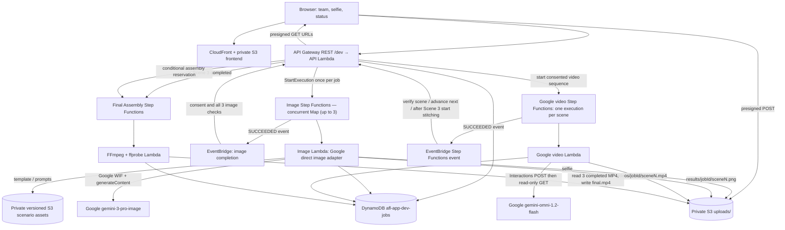

# AFL Video Platform — Current Architecture

**Audit:** 15 November 2026 (post stages 1–3) | **Source:** `main` repository | **Confidence:** SOURCE VERIFIED; guarded AWS release logs verify API, EventBridge rules and frontend assets; full unattended real-job run and independent infrastructure drift scan remain outstanding.

**Source of truth:** `src/api/handler.py`, `src/image_worker/{handler.py,google_direct.py}`, `src/google_video_worker/handler.py`, `src/assembly_worker/handler.py`, `frontend/{index.html,app.js}`, `infrastructure/app/{backend,google-video,assembly,frontend}.yaml`.

> This document describes the **currently implemented source**, not historical plans. Payment and refunds are **not implemented**. Existing references to "paid" mean Google model calls that incur provider cost, **not Stripe authorisation**.

## Architecture and flow

The diagram is a logical model. After browser upload, job creation and the single `POST /jobs/{jobId}/generate`, **AWS owns the image-completion → Video 1 → Video 2 → Video 3 → final assembly progression**. API Lambda receives EventBridge successful-execution events, verifies prior durable state and conditionally reserves the next step. Browser progress GETs do not submit videos or stitching. Diagram does not represent retries, IAM boundaries or all infrastructure.

### 1. Upload / job creation

1. Browser calls `POST /uploads` for regional SigV4 S3 presigned POST. Accepts JPEG/PNG/WebP, 1–10MiB, expires 300s.
2. Browser sends selfie directly to private S3 `uploads/{uuid}.{ext}`.
3. Browser calls `POST /jobs` with `uploadKey`, scenario/team/names, `confirmPaidSequence: true`, and `Idempotency-Key`; API HEAD-checks file, validates input, conditionally creates `afl-app-dev-jobs` record with `AWAITING_IMAGE_PIPELINE`, `autoVideoConsent: true` and default seven-day TTL. This is developer-mode permission for Google-cost video calls, **not Stripe payment verification**.
4. **Current frontend immediately starts reference images after job creation**. This is a critical requirement to change *later* when Stripe is introduced: no chargeable model calls before verified payment.

### 2. Reference images

`POST /jobs/{jobId}/generate` starts named STANDARD Step Functions execution `jobId`. Source image workflow `afl-app-dev-scene1-pilot` (historical name) has `Prepare → ParallelScenes [Map MaxConcurrency:3] → Finalize`, with Catch to `RecoverJob`. All three image branches can run concurrently **within a job**, with independent per-scene 429 retry waits; this is not an account-wide Google/API concurrency limit.

For each scene, image worker reads job/selfie and versioned team template/prompt from S3, authenticates using AWS→Google Workload Identity Federation (WIF), and POSTs directly to Vertex `gemini-3-pro-image:generateContent`. Google responds synchronously with image content; worker validates/converts to PNG and writes `results/{jobId}/sceneN.png`, then persists per-scene `COMPLETED`.

Only an explicit HTTP 429 rejection allows automatic new image model submission: up to eight attempts total within 600s retry window, with bounded exponential delay/jitter and respect for Retry-After. Ambiguous POST timeouts are *not* automatically retried. Failed image map iteration is marked failed and Map can progress to another scene; no automatic resume of failed image from checkpoint exists.

Current image master mapping in `src/image_worker/handler.py` chooses the masked `sceneN-start-masked.png` master only for Collingwood scenes 1 and 3; other team/scene combinations use `sceneN-start.png`. Do not generalise masked templates to all teams without checking actual code/assets.

### 3. Real video scenes

After the image Step Functions execution SUCCEEDS and all three reference images are durable, the **image-completion EventBridge rule** invokes API Lambda `image_sequence_event()`. It requires the job's previously stored `autoVideoConsent: true`, exact named image-workflow execution, image job `COMPLETED` and all three scene records `COMPLETED`, then internally reuses `start_video_sequence()`. The legacy public `POST /jobs/{jobId}/real-videos/sequence` remains available for guarded developer/manual use, but the current browser no longer calls it. The sequence approval is conditional and reserves the first missing scene. First missing original scene starts via `POST .../real-videos/{scene}` internal handler using stable execution name `real-{jobId}-sceneN`. API refuses starting scene 2 before scene 1, or scene 3 before scene 2, without a durable completed prior MP4.

Video STANDARD Step Functions `afl-app-dev-google-omni`: `PaidGate → Claim → SubmissionSchedule → Submit → WaitForVideo (20s) → PollVideo → InspectVideo`, looping until done, then `Finalize`. Source includes 10-second scene 2 and 20-second scene 3 scheduling waits. Only **read-only PollVideo** has Step Functions retry: 3 retries (10/20/40 seconds); paid `Submit` has none.

Worker uses Google `gemini-omni-1.2-flash` on Vertex Interactions v1beta1, POST `.../interactions` followed by GET `.../interactions/{interactionId}`. It records `SUBMISSION_UNKNOWN` *before* paid POST, so lost acknowledgements cannot safely trigger another submission. On accepted response, stores `interactionId` and `PROCESSING`, polls, validates completed MP4 (inline or private Google Cloud Storage output if configured), writes `videos/{jobId}/sceneN.mp4` and persists `COMPLETED`.

Successful Step Functions execution emits an EventBridge status-change event to API Lambda's `video_sequence_event()`. This verifies original/stored scene status and S3 object then starts the next missing scene, with conditional DDB guards against duplicate events. Failures can stop advancement and require scene-specific manual retry (max **10 total attempts**, only confirmed terminal provider failure and safe completed previous workflow). **This is not yet automatic customer recovery.**

### 4. Final assembly and customer delivery

All three real MP4 scene keys must exist and be marked `COMPLETED`. The existing **video-completion EventBridge rule** sends Scene 3 successful execution to API `video_sequence_event()`, which verifies the current scene attempt, the completed scene-3 MP4 and its S3 object, and calls `start_assembly()`. That existing function verifies all three completed MP4s exist, conditionally persists `assembly:QUEUED`, and starts named `final-{jobId}` assembly execution. Duplicate events cannot create a second assembly. The browser does not initiate stitching; **lost AWS handoffs and failed/stalled assembly still require a recovery solution**.

FFmpeg Lambda downloads three MP4s, probes each, normalises to 720×1280/30fps with H.264/AAC, concat-copies final MP4, uploads `videos/{jobId}/final.mp4`, HEAD-verifies and writes `assembly:COMPLETED`. Assembly has no Step Functions Retry/Catch; input clips are retained on S3 failures. Frontend stitching percentage is a **visual-only ten-second estimate**, not a measured FFmpeg percentage. Final download filename is `afl-grand-final.mp4`, via 300-second signed S3 URL.

## Status and diagnostics boundaries

An **implemented read-only end-to-end status projection** exists: `GET /jobs/{jobId}` includes `job.progress` with `currentStage`, `stageStatus`, image/video completion counts and `finalVideoReady`, derived from existing persisted image/video/assembly records. Legacy `job.status` remains the **image job status**, not a renamed global status. `GET /jobs/{jobId}/videos` reports per-scene progress plus assembly, and `GET /jobs/{jobId}/assembly` reports the final result. Video IDs and failure/retry metadata remain available to developer diagnostics. Normal frontend image/video polling is five seconds (fifteen on error); the **overall status line** polls every two seconds while its developer diagnostics panel is expanded and visible. Neither polling path submits paid video or stitching.

See [JOB_STATUSES.md](JOB_STATUSES.md) and [API_ENDPOINTS.md](API_ENDPOINTS.md) for exact response shapes and statuses. Do **not** expose provider diagnostics, keys or media outside authorised customer access after payments.

## Infrastructure and operations

- AWS region: source configured `ap-southeast-2`. CloudFormation stacks include `afl-app-dev-backend`, `afl-app-dev-google-video`, `afl-app-dev-assembly`, `afl-app-dev-frontend`, and a separate legacy `afl-app-dev-video`; bootstrap stack manages shared artifacts/deploy foundation.
- Jobs and media remain in private S3/DynamoDB; frontend is public HTTPS CloudFront backed by private S3 via OAC.
- Application deploy via GitHub Actions OIDC, CloudFormation and source/release scripts. `.github/workflows/release.yml` contains controlled changeset preview and separately gated backend deployment, plus historical one-shot jobs; don't assume a source commit automatically deployed.
- Logs in CloudWatch, explicit 14-day Lambda log group retention in source; image watchdog EventBridge `rate(5 minutes)` terminalises stalled image jobs older than 45 minutes without new Google POSTs.
- API Gateway developer `x-api-key` gates pilot routes; no per-customer authentication/entitlements, Stripe or refund records exist.

Full inventory: [INFRASTRUCTURE.md](INFRASTRUCTURE.md). Retry matrix: [RETRIES_AND_TIMEOUTS.md](RETRIES_AND_TIMEOUTS.md). Source/deployment evidence limitations: [DEPLOYMENT_BASELINE_2026-11-15.md](DEPLOYMENT_BASELINE_2026-11-15.md).

## Known gaps before charging consumers

1. No payment verification before current automated image generation.
2. No secure anonymous order/job recovery on browser reload.
3. The read-only `job.progress` projection is implemented and deployed; a persisted unified global state/event log is **not** implemented. Preserve existing compatibility.
4. Ambiguous Google responses/unknown operations can require manual reconciliation.
5. Video scene retry requires developer/user action, not bounded automatic consumer recovery.
6. Final assembly **is backend-triggered** after Scene 3 success; assembly workflow still has no automatic recovery/retry or lost-handoff reconciliation.
7. Seven-day upload/results/job TTL is not coordinated with paying customer support/refund retention; `videos/` lifecycle requires review.
8. Developer API key not customer authorisation; API status must be guarded per job.
9. Some historical API messages still mention Replicate; `parallelScenes:true` now correctly reflects the image Map concurrency but should not be interpreted as unrestricted provider throughput.
10. Configured AWS values must be checked against active live resources before production sign-off.

**Documentation revision only:** no prompts, model calls, code, AWS infrastructure or payment logic were modified while updating this file. Backend handoffs were separately deployed in [Stage 1](https://github.com/rorygleeson/afl-video-platform/actions/runs/43689396745), [Stage 2](https://github.com/rorygleeson/afl-video-platform/actions/runs/43689754297) and [Stage 3](https://github.com/rorygleeson/afl-video-platform/actions/runs/43690121205). No new full paid end-to-end run was made as part of this document review.
