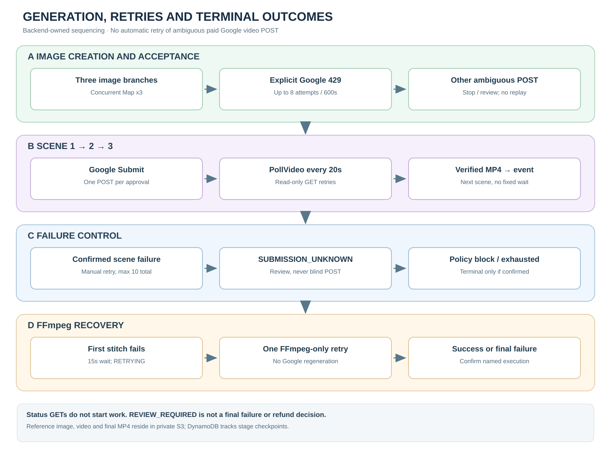

# AFL Video Platform — failure recovery and incident triage runbook

**Source reviewed:** 16 November 2026. **Status: engineering reference / read-only triage only.** This runbook was derived from `src/api/handler.py`, `src/google_video_worker/handler.py`, `src/image_worker/{handler.py,google_direct.py}`, `src/assembly_worker/handler.py`, `src/handoff_watchdog/handler.py` and related AWS templates. **No destructive or paid recovery automation is implemented here.** Before acting on production jobs, validate active AWS role permissions, current deployment SHA, customer access controls, media retention and billing implications.

## Core rule

**Read existing evidence before starting anything.** A returned error or absence of a Google interaction ID does **not** prove a paid Google POST was rejected. A customer asking for a new video is a separate business decision from reconciling the old job.

For operational diagnostics, use trusted internal AWS tooling or an appropriately authorised operator connection; never post customer selfies, presigned links, bearer tokens, paid provider response bodies or API secrets to tickets or logs. This developer pilot has a shared `x-api-key`; paying-customer entitlement/access is **not yet available**.

## Inspect the four independent authorities

| Evidence | Where to look | Meaning | Misinterpretation to avoid |
|---|---|---|---|
| **DynamoDB checkpoint** | `afl-app-dev-jobs` by `jobId` | Current image scenes, `paidVideoApprovals`, `realVideos`, `videoSequence`, `assembly`, timestamps | A reservation alone does not prove a named SFN was started |
| **Named Step Functions execution** | Image `{jobId}`, Google `real-{jobId}-sceneN[-rN]`, assembly `final-{jobId}`, watcher `watch-{jobId}` | RUNNING/SUCCEEDED/FAILED/TIMED_OUT/ABORTED and actual task execution timeline | SFN SUCCEEDED alone does not prove final S3 media is present |
| **Private S3 output** | Expected `results/{jobId}/sceneN.png`, `videos/{jobId}/sceneN.mp4`, `videos/{jobId}/final.mp4` | HEAD existence, size, metadata, last modification | An expired 300-second signed URL is **not** proof the S3 object was deleted |
| **Google interaction** | Stored provider `interactionId` (when present) and safe provider failure code | Existing asynchronous model operation can be read/polled | An absent interaction ID after POST timeout **cannot** prove nonacceptance or refund eligibility |

Use `GET /jobs/{jobId}` → `job.progress` as a **read-only overview**, and `GET /jobs/{jobId}/videos` → per-scene `videos` and `assembly` for scoped status. Developer diagnostics may perform a safe Google GET but no generation POST. The API's `job.status` still only describes the **reference-image workflow**, not overall final-video delivery.

## First 60 seconds: triage checklist

1. Record `jobId` (not a signed URL or selfie), last observed `progress.currentStage`, `stageStatus`, `terminal`, `outcome` and visible failure reason. Do not start the same paid scene again.
2. Read the relevant DynamoDB checkpoint and its owner `requestId` / named execution name. Verify current attempt vs older archived retry history.
3. Describe the matching named SFN execution. Distinguish running, completed, missing, failed or unknown **without guessing**.
4. For a recorded completed image/video/final, HEAD the expected private S3 object. A mismatched/missing object is review, not a reason to re-generate.
5. If Google `SUBMISSION_UNKNOWN`, preserve all evidence and do **not** reissue a POST. If interaction ID is known, read **that existing interaction** only.
6. If the apparent failure is a handoff, check event-source SFN SUCCEEDED and application-level Lambda outcome. Delivery may have succeeded even if the next business task returned `NEEDS_REVIEW`.
7. Record an operator review action with cause/evidence. **There is no implemented durable review queue, alert or payment/refund ledger yet**; do not pretend an incident is being automatically followed up.

## Failure decision matrix

| Observable symptom | Evidence required | Interpretation | Safe next step / forbidden step |
|---|---|---|---|
| `IMAGES/RETRYING`, scene `RETRY_WAIT` | Last Google call was explicit HTTP **429**; nextRetryAt and attempt/window | Rejected request, bounded image-only retry | Let existing SFN Wait and image worker retry (max 8 total in 600s). **Do not** launch a second image job |
| Image scene `FAILED` due to POST timeout/5xx | Source worker errorCode; SFN history, known image output | Provider acceptance may be unknown | Review source/output; **no blind paid Google POST** |
| Image job `PARTIAL_SUCCESS` | Three scene statuses; image SFN and S3 keys | End-to-end video cannot safely start | Preserve successful image outputs; final outcome is `REFERENCE_IMAGES_FAILED` |
| Video `REQUESTED`, SFN not found | `paidVideoApprovals.sceneN.executionName`, DescribeExecution | DDB reserved before StartExecution; handoff ambiguous | Investigate start acknowledgement/identity; do not create a *different* paid execution blindly |
| Video `PREPARED` | Worker claim and named execution state | Paid POST not yet proven submitted | Inspect safe SFN progress; don't start another scene |
| Video `SUBMISSION_UNKNOWN` | `submissionStartedAt`, errorCode, named execution, optional provider ID | State was set **before** POST; Google may have accepted/charged | Preserve reservation, investigate read-only evidence; **no new POST or automatic refund** |
| Video `PROCESSING` with saved `interactionId` | Google GET / worker polling task and SFN state | Accepted asynchronous interaction is still active | Read existing interaction; account for 20s Wait and PollVideo GET retries; do not resubmit |
| Provider `FAILED`, attempts less than 10 | Provider final status and previous SFN `SUCCEEDED`, unchanged image S3 | Eligible for *explicit* developer/user-confirmed retry only | Preserve previous attempt history; new attempt requires separate confirmation |
| Provider content refused | `videoSequence.BLOCKED` and matching failure record | Definitive `CONTENT_BLOCKED` | Terminal. Never retry scene or continue subsequent scenes |
| Video scene `COMPLETED` but next still `NOT_REQUESTED` | Prior SFN SUCCEEDED, current approval, expected S3 MP4 HEAD, EventBridge event and watchdog | Possible lost/downstream handoff | Safe verified event replay via existing API/watchdog when eligible; **do not** call Google POST directly |
| Next scene reserved but SFN missing | `NEXT_SCENE_HANDOFF_NEEDS_REVIEW`, named execution absent | Application-level handoff uncertainty; EventBridge delivery may already be successful | Durable operator investigation needed; no blind re-reservation |
| Assembly first worker `FAILED,retryCount=0`, SFN `RUNNING` | Named `final-{jobId}` state and checkpoint | **First stitch failed; safe retry settling** | Report `STITCHING/RETRYING`; wait 15s + existing FFmpeg-only retry. **Do not refund/terminate** |
| Assembly `FAILED,retryCount=1`, SFN `FAILED` | Durable second failed worker plus named SFN FAILED | Definitive exhausted recovery | `STITCHING_FAILED` terminal; preserve source MP4s |
| Assembly `PROCESSING` with timed-out SFN | DDB updatedAt, SFN TIMED_OUT/ABORTED, S3 final object | Unknown writer completion | Nonterminal `REVIEW_REQUIRED`. No second FFmpeg writer until safe evidence/reconciliation |
| `COMPLETED` but download returns 403 | New signed URL generation and S3 HEAD | Could be **expired link**, not lost final video | Refresh through authorised status GET; verify object and media lifecycle |
| `COMPLETED` but S3 final object absent | Final resultKey, S3 HEAD, object lifecycle and assembly history | Delivery promise inconsistent | Raise incident; **do not claim successful customer delivery** |
| Watchdog missing or expired | Named `watch-{jobId}` absent / 7200s cutoff / prior RUNNING start event | Automatic recovery coverage may no longer exist | Record manual review and route to future durable monitor; no guessed outcome |

## EventBridge versus Lambda async retry: three failure layers

1. **EventBridge target delivery failure:** rule `RetryPolicy` controls accepted delivery to the Lambda target. Completion rules configure **3600s maximum age / 24 delivery attempts**; watchdog start rule **3600s / 12**. Source shows **no target DLQ**.
2. **Lambda asynchronous execution error:** after a successful asynchronous invoke, the Lambda queue owns function-execution retries (AWS defaults can be overridden). Source of this platform has **not independently verified active async retry configuration**.
3. **Business failure returned normally:** `video_sequence_event` may return `NEXT_SCENE_HANDOFF_NEEDS_REVIEW` or `ASSEMBLY_HANDOFF_NEEDS_REVIEW` without throwing. This is a **successful function return**; neither the EventBridge delivery retry nor Lambda function-error retry is triggered by that business return. Recovery depends on another event, watchdog or operator.

AWS service references: [EventBridge Lambda target](https://docs.aws.amazon.com/us_en/eventbridge/latest/userguide/eb-custom-bus-target-lambda.html), [Lambda async function-error retry](https://docs.aws.amazon.com/lambda/latest/dg/invocation-async-error-handling.html), [EventBridge delivery monitoring](https://docs.aws.amazon.com/eventbridge/latest/userguide/eb-monitoring-events-best-practices.html).

## Proposed escalation and success criteria (NOT implemented)

- An **operator-review record** should contain a bounded code (`UNKNOWN_PAID_SUBMISSION`, `NEXT_SCENE_HANDOFF_NEEDS_REVIEW`, `WATCHDOG_NOT_STARTED`, `ASSEMBLY_STATUS_MISMATCH`, `FINAL_MEDIA_MISSING`), created/lastChecked times, owning job/scene and stable execution name, next permitted *read-only* check, and support owner. Avoid sensitive provider payload.
- **Operational metrics:** missing watchdog startup, completion-to-next-SFN latency, stale paid reservation, Google 429 rate, unknown provider operation age, total image/job age, assembly retry exhaustion, missing final MP4, EventBridge `FailedInvocations` and Lambda async invocation errors/dropped results.
- **No Stripe automatic refund decision** while the provider POST is unknown, an assembly retry is pending, or a review state remains unresolved. Use a separate durable payment/order ledger with retention beyond the seven-day DynamoDB job TTL.
- **Acceptance test:** fault-inject lost image/video completion event, an accepted-but-unacknowledged Google POST, duplicate/reordered event, expired signed link, and FFmpeg first/second failure. For each, prove correct DDB/SFN/S3 checkpoint and **zero unexpected paid Google POSTs**. Confirm correct customer status on refresh and a durable review path.

Related [event-driven architecture](EVENT_DRIVEN_ARCHITECTURE.md), [API route contract](API_ENDPOINTS.md), [retry limits](RETRIES_AND_TIMEOUTS.md), [status semantics](JOB_STATUSES.md), [ranked resilience audit](RESILIENCE_AUDIT_2026-11-16.md). These references are current source contracts; early Replicate and manual video approval plans are historical.
