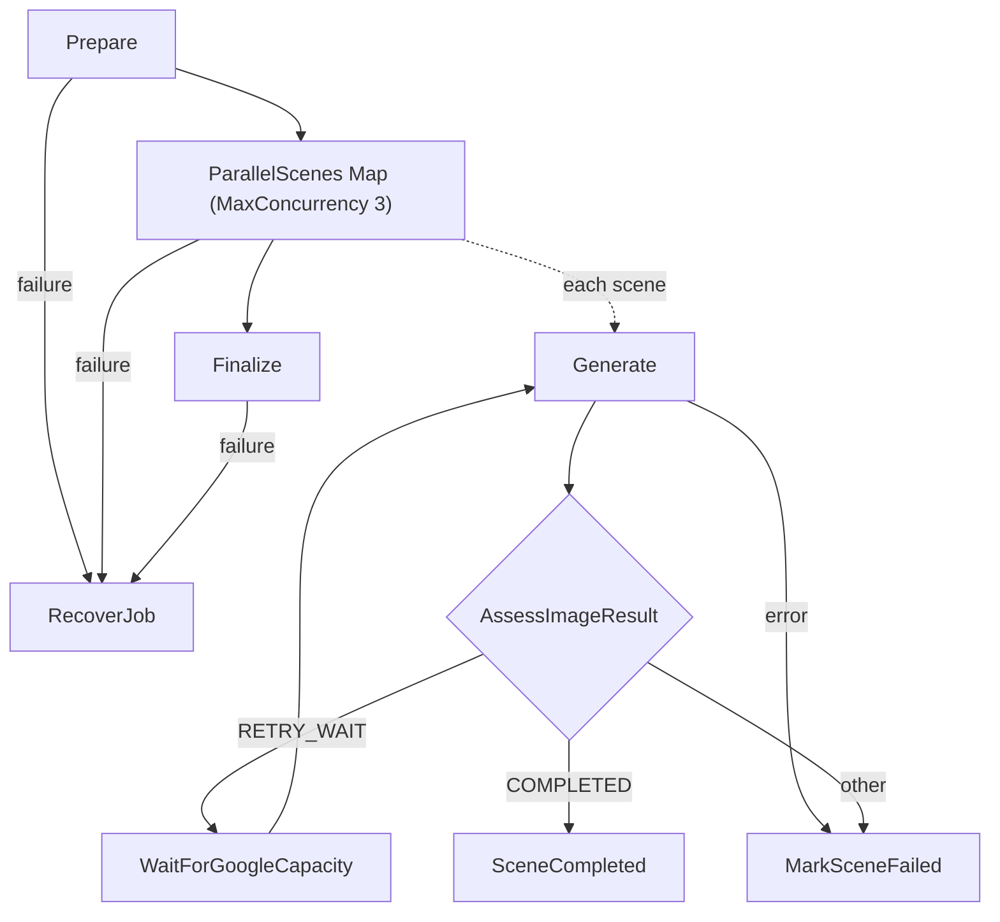
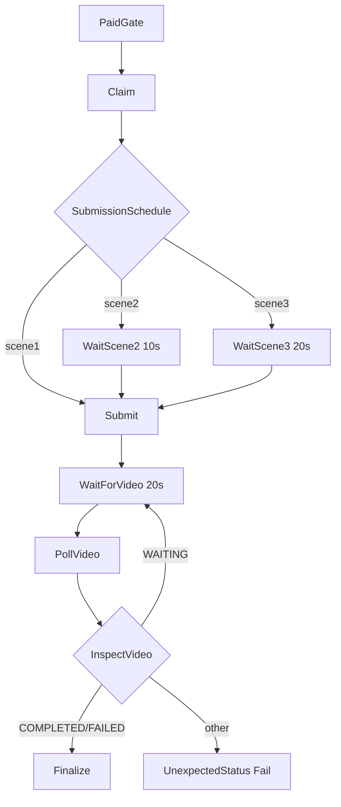

# AFL Video Platform — AWS Infrastructure Inventory

**Source audit:** 15 November 2026, post backend-orchestration releases. **Classification:** SOURCE VERIFIED; guarded CloudFormation API/EventBridge deployments and frontend S3 publication verified in GitHub Actions. Full live AWS environment parameters, runtime settings, drift, monitored event delivery and end-to-end generation **NOT independently verified**. This file describes source plus specific release evidence, not a complete live AWS inventory.

**Authoritative source:** `infrastructure/app/backend.yaml`, `google-video.yaml`, `assembly.yaml`, `frontend.yaml`, `image-video-start-events.yaml`, `video-sequence-events.yaml`; `src/{api,image_worker,google_video_worker,assembly_worker}`; `.github/workflows/{release,deploy-aws-background-video,deploy-auto-video-start-ui}.yml`; `scripts/{capture_release_baseline,deploy_aws_background_video}.py`.

## CloudFormation stack ownership

| Stack | Purpose | Source / evidence |
| --- | --- | --- |
| `afl-app-dev-backend` | Upload/media bucket, jobs table, REST API, API/image/legacy auth Lambdas, image SFN and image watchdog | `infrastructure/app/backend.yaml` |
| `afl-app-dev-google-video` | Real Google Omni worker, WIF env, video SFN | `infrastructure/app/google-video.yaml` |
| `afl-app-dev-assembly` | FFmpeg layer, assembly Lambda and SFN | `infrastructure/app/assembly.yaml` |
| `afl-app-dev-image-video-start-events` | Image Step Functions success → consent-gated Video 1 API handler | `infrastructure/app/image-video-start-events.yaml` |
| `afl-app-dev-video-sequence-events` | Google video success → next scene or final assembly API handler | `infrastructure/app/video-sequence-events.yaml` |
| `afl-app-dev-frontend` | Private frontend S3 and CloudFront | `infrastructure/app/frontend.yaml` |
| `afl-app-dev-video` | Historical mock workflow / video admission infrastructure | Current baseline script inventories; detailed current stack template still to cross-check |
| `afl-video-bootstrap` | Existing bootstrap/artifact/deployment role foundation | Historical bootstrap docs; not recreated in normal app deployment |

**Warning:** CloudFormation templates can have misleading old descriptions or hard-disabled *default* parameters (`PaidVideoEnabled: false`, `AssemblyEnabled: false`). Those defaults do **not** establish active stack parameter values. Source code supports real video and assembly, but live enablement must be checked in active parameters/environment.

## Lambda inventory

| Name | Handler source | Runtime | RAM | Timeout | Ephemeral | Purpose |
| --- | --- | --- | ---: | ---: | ---: | --- |
| `afl-app-dev-api` | `src/api/handler.py` / `handler.lambda_handler` | Python 3.13 | 256 MiB | 15s | Not explicitly set | API route/proxy, job lifecycle, signed links, scene admission and EventBridge sequencing |
| `afl-app-dev-image-worker` | `src/image_worker/handler.py`, `google_direct.py` | Python 3.13 | 1024 MiB | 600s | Not explicitly set | Preflight, direct Google images, S3 results, DDB checkpoints, watchdog |
| `afl-app-dev-video-worker` | Legacy video-auth handler | Python 3.13 | 256 MiB | 50s | Not explicitly set | Developer Google WIF auth check only; not real paid video |
| `afl-app-dev-google-omni-worker` | `src/google_video_worker/handler.py`, `video_prompts.py` | Python 3.13 | 1024 MiB | 300s | 512 MiB | Google Interactions POST/GET, per-scene MP4 output, safe transition/diagnostics |
| `afl-app-dev-assembly` | `src/assembly_worker/handler.py` | Python 3.13, x86_64 | 2048 MiB | 600s | 2048 MiB | FFmpeg/ffprobe layer, reads scene MP4s, final stitched MP4 |

**Concurrency:** The principal CloudFormation Lambda resources reviewed do not explicitly declare `ReservedConcurrentExecutions`. Do not infer actual concurrency limits, unreserved capacity or provider quotas without live AWS checks. Image Map has concurrency **up to 3 per image job execution**, not a global account concurrency cap. Video sequencing orders scenes *within a job*, not necessarily across multiple customers. Historical global video admission slot is retired for real Google video (`release()` is a no-op) but legacy mock admissions differ.

### Environment variable **names** (values and secrets intentionally excluded)

- **API:** `UPLOAD_BUCKET`, `JOBS_TABLE`, `FRONTEND_ORIGIN`, `IMAGE_STATE_MACHINE_ARN`, `VIDEO_WORKER_ARN`, `GOOGLE_WORKER_ARN`, `GOOGLE_STATE_MACHINE_ARN`, `REAL_VIDEO_MODE`, `ASSEMBLY_STATE_MACHINE_ARN`, `SCENARIO_ASSET_BUCKET`, `VIDEO_STATE_MACHINE_ARN`, `VIDEO_MODE`, `VIDEO_ADMISSION_TABLE` plus runtime `AWS_REGION`.
- **Image:** `UPLOAD_BUCKET`, `ASSET_BUCKET`, `JOBS_TABLE`, `GOOGLE_PROJECT_ID`, `GOOGLE_PROJECT_NUMBER`, `GOOGLE_WIF_POOL_ID`, `GOOGLE_WIF_PROVIDER_ID`, `GOOGLE_SERVICE_ACCOUNT`, `GOOGLE_IMAGE_MODEL`, `SCENARIO_CONFIG_KEY` plus runtime `AWS_REGION`.
- **Google video:** `PAID_GENERATION_ENABLED`, `GOOGLE_VIDEO_MODEL`, `GOOGLE_VIDEO_OUTPUT_GCS_PREFIX`, `GOOGLE_PROJECT_ID`, `GOOGLE_PROJECT_NUMBER`, `GOOGLE_WIF_POOL_ID`, `GOOGLE_WIF_PROVIDER_ID`, `GOOGLE_SERVICE_ACCOUNT`, `UPLOAD_BUCKET`, `JOBS_TABLE`, `ADMISSION_TABLE`, `SCENARIO_ASSET_BUCKET`.
- **Assembly:** `UPLOAD_BUCKET`, `JOBS_TABLE`, `FFMPEG_PATH`, `FFPROBE_PATH`.
- **Legacy auth:** `GOOGLE_PROJECT_NUMBER`, `GOOGLE_WIF_POOL_ID`, `GOOGLE_WIF_PROVIDER_ID`, `GOOGLE_SERVICE_ACCOUNT`, `VIDEO_GENERATION_ENABLED`.

**Dependencies:** Python boto3/botocore, google-auth/WIF in Google workers, Pillow for image JPEG/WEBP normalisation, FFmpeg + ffprobe packaged in a dedicated layer. Exact pinned wheel versions/ZIP contents must be extracted from build scripts/manifests and compared with deployed ZIP hashes before marking dependencies fully verified. The Google worker uses `urllib.request` for provider Interactions calls and explicit HTTP socket timeouts, not a generic Google video SDK.

### Error handling and retry ownership

- API: returns JSON 400, 404, 409, 500 or 503 as appropriate; 202 only means queued/requested. Conditional DDB claims protect generation submission; errors from ambiguous SFN handoff are not blindly retried.
- Image Lambda: per-scene conditional state transitions; explicit 429 only may generate `RETRY_WAIT` and reenter via SFN Wait, with max 8 model attempts/600s retry window. Other errors cause failed stage; image watchdog only terminalises stale work.
- Video Lambda: writes `SUBMISSION_UNKNOWN` before POST, persists Google `interactionId` when returned, polls read-only, and records provider status. **No automatic paid Submit retry**; read-only polling TaskFailed retry configured in SFN.
- Assembly Lambda: conditionally `QUEUED → PROCESSING → COMPLETED|FAILED`, attempts failure status persistence but no SFN Retry/Catch. All three input MP4s are retained on failure.
- Detailed retry/timeout matrix: [RETRIES_AND_TIMEOUTS.md](RETRIES_AND_TIMEOUTS.md).

## Step Functions inventory

### Images — `afl-app-dev-scene1-pilot`

**Type:** STANDARD; `TimeoutSeconds: 1800`; main states and links:

- `Prepare` Lambda `op:prepare`, locks input assets in preflight, updates DDB.
- Inline Map `ItemsPath: $.prepared.Payload.scenes`, three scene IDs, `MaxConcurrency:3`. This permits all three image branches to execute concurrently; each scene independently handles 429 wait/retry and completion/failure.
- Each `Generate` invokes image worker `op:generate`; a returned `RETRY_WAIT` causes Wait `SecondsPath: $.attemptResult.Payload.retryAfterSeconds`, then new invocation; errors go to `op:failed`.
- `Finalize` updates overall status based on 3 scene states. Catch from Prepare, Map or Finalize goes to `RecoverJob` (worker `op:recover`), preserving successful image checkpoints and terminalising incomplete scenes.
- No general SFN Task retry for Google image; all re-submissions originate only from bounded explicit 429 application logic.

### Real video — `afl-app-dev-google-omni`

**Type:** STANDARD; `TimeoutSeconds:3600`; per-scene named execution:

- `PaidGate` and `Claim` enforce current dev approval and per-scene ownership. **No Stripe payment verification exists**.
- `Submit` is a single billable POST **without** a state-machine Retry.
- `PollVideo` has `Retry: [{ErrorEquals:[States.TaskFailed], IntervalSeconds:10, MaxAttempts:3, BackoffRate:2}]` — initial + up to 3 extra read-only invocations.
- Each provider `WAITING` status loops via another 20s Wait. Unknown status enters explicit Fail, not a new generation.
- Successful image workflow completion emits an EventBridge event (dedicated `afl-app-dev-images-to-video` rule); API checks persisted consent and three completed images before starting Video 1. Successful Google video workflow emits another event (dedicated `afl-app-dev-google-video-completed` rule). API checks attempt ownership and S3/DDB completion before advancing to Video 2/3; **after verified Scene 3**, handler now calls `start_assembly()` and starts `final-{jobId}` only once, using existing conditional DDB reservation.
- 10 total attempts per failed scene (API enforces user-confirmed retry eligibility after provider terminal failure and previous workflow safely stopped).

### Final assembly — `afl-app-dev-assembly`

**Type:** STANDARD; one `Stitch` Lambda Task. No explicit `TimeoutSeconds` at state-machine level, Retry or Catch in current definition. Actual Lambda timeout **600s**. Named execution `final-{jobId}` prevents second identical SFN execution; worker does not reset `FAILED` to `QUEUED` today.

### Legacy mock — `afl-app-dev-video`

Referenced by API for `POST /jobs/{jobId}/videos/{scene}`, a *mock-only* route; template/state inventory requires its source/template cross-check separately. Never treat mock success as real Google completion.

## DynamoDB inventory

### Job table: `afl-app-dev-jobs`

Source `AWS::DynamoDB::Table` with:
- Partition key: **`jobId`** (String); **no sort key in source**.
- Billing: `PAY_PER_REQUEST`; table SSE enabled; resource `DeletionPolicy: Retain` and `UpdateReplacePolicy: Retain`.
- TTL: `expiresAt` numeric epoch seconds, enabled. `POST /jobs` currently writes **now + 7 days**. TTL expiry is asynchronous, not exact deletion at the timestamp.
- PITR, streams, GSIs and backups: not explicitly configured in this template; must be checked live before making claims about availability.

### Main item fields (current code, dynamic)

| Field | Writer | Meaning |
| --- | --- | --- |
| `jobId`, `scenarioId`, `team`, `firstName`, `lastName`, `uploadKey` | API `create_job` | Job identity/input |
| `requestFingerprint`, `createdAt`, `expiresAt`, `status` | API `create_job` | Idempotent creation, TTL and overall **image** job state |
| `autoVideoConsent` | API `create_job` | Boolean set from `confirmPaidSequence` at job creation; authorises AWS image-success → Video 1 progression in developer-mode; **not** a verified Stripe entitlement |
| `scenes.sceneN` | Image worker | `status`, `resultKey`, `errorCode`, `attemptCount`, `retryCount`, `maxRetries`, `firstAttemptAt`, `nextRetryAt`, `generationStartedAt`, `completedAt`, etc. |
| `sceneCount`, `completedScenes`, `failedScenes`, `generationStartedAt`, `completedAt`, `teamMasterKeys` | Image worker | Counts, start/end, source master locking |
| `videoSequence` | API | `APPROVED`, `AWS_EVENT_DRIVEN`, approval timestamp/fingerprint |
| `paidVideoApprovals.sceneN` | API | `REQUESTED`, executionName, fingerprint, attemptNumber, retry history; means Google-cost approval, **not Stripe payment** |
| `realVideos.sceneN` | Google video worker | `PREPARED`, `SUBMISSION_UNKNOWN`, `PROCESSING`, `COMPLETED`, `FAILED`; `requestId`, `interactionId`, source image, `resultKey`, provider error classification, timestamps |
| `videos.sceneN` | Legacy mock | Mock-only statuses; must not be treated as playable MP4 |
| `assembly` | API and assembly worker | `QUEUED`, `PROCESSING`, `COMPLETED`, `FAILED`; created/updated times, `resultKey`, `sizeBytes`, `errorCode` |

**Concurrency and recovery:** DDB conditional writes prevent duplicate job/scene starts and protect transitions by owner/status. Completed scene results are separate fields; a failure in video 2 should not erase video 1. But lost provider acknowledgements, post-S3/pre-DDB failures and abandoned assembly require additional reconciliation. Jobs expiring after seven days can lose payment recovery records if TTL isn't redesigned.

### Video admission table

Source backend template expects `afl-app-dev-video-admission` (and `ADMISSION_TABLE` in video worker). Existing real video worker `release()` explicitly describes the global concurrency slot as retired; `SLOTS` remains instantiated and legacy mock admission may use the table. Full table physical definition/key/lifecycle is **not established** from the four reviewed app templates and must be audited from the legacy video stack before declaring it unused.

## S3, CloudFront and media inventory

### Private upload/results/videos bucket

Source name pattern: `afl-app-dev-uploads-${AWS::AccountId}-${AWS::Region}`; public access block all enabled; AES-256 SSE-S3; browser upload CORS limited to configured `FrontendOrigin`.

| Prefix/key | Purpose | Lifecycle evidenced in source |
| --- | --- | --- |
| `uploads/{uuid}.{jpg,png,webp}` | Customer selfie | **7-day expiration** for `uploads/` |
| `results/{jobId}/sceneN.png` | Three Google reference images | **7-day expiration** for `results/` |
| `videos/{jobId}/sceneN.mp4` | Three Google video clips | **No explicit `videos/` expiration** in the reviewed bucket template; live bucket policies not checked |
| `videos/{jobId}/final.mp4` | FFmpeg final deliverable | Same `videos/` prefix |
| Incomplete multipart uploads | Cleanup | Abort after 1 day |

A key property: an absent S3 lifecycle rule in source is **not proof** there are no externally configured lifecycle rules in AWS. Signing links gives temporary access (typically **300 seconds**); expiry of signed URL is separate from object retention. Media remain private; frontend never directly reads private bucket without presigned permission.

### Scenario assets

Versioned scenario configuration/prompt and team master artwork under `scenarios/afl-grand-final-winning-kick/v1/` in the private scenario asset/artifact bucket configured by CloudFormation. Sources locked before image generation; scenario config validates team and scene image model. **Do not change prompts, images or team artwork during documentation audit.**

### Frontend bucket and CDN

`infrastructure/app/frontend.yaml` defines private S3 hosting with CloudFront Origin Access Control (OAC), default `index.html`, `PriceClass_100`, HTTP→HTTPS redirect. S3 public access remains blocked. Frontend `index.html`, `app.js` and `config.js` supply user interface and API base URL; code updates and CloudFront invalidation are managed through existing GitHub release workflows/scripts.

## API Gateway and credentials

- REST `ANY /{proxy+}` → Lambda AWS_PROXY, method API key required, `AuthorizationType:NONE`; CORS `OPTIONS /{proxy+}` mock without key.
- Source usage plan: rate **5 requests/s**, burst **10**, quota **10,000/month**. This is a plan configuration, **not a guarantee of effective throttling or customer security**. Live stage/usage plan and gateway integration timeout must be checked.
- API Lambda default 15s. Application responds 202 for async accepted work, and uses per-stage GET endpoints for status. See [API_ENDPOINTS.md](API_ENDPOINTS.md).
- Google authentication uses AWS Workload Identity Federation with Google token exchange and impersonation. No customer Google secret in frontend. Actual Google quotas, service account permissions and Cloud auth configuration require provider-side verification.
- GitHub Actions uses OIDC `aws-actions/configure-aws-credentials@v4`; private deployment role assumed in `ap-southeast-2`. Baseline and deployment workflows intentionally separate read-only previews and change-set execution gates. Do not run deploy-capable workflows to inspect source.

## Monitoring, events and release controls

- Source CloudWatch log groups `/aws/lambda/afl-app-dev-api`, `...image-worker`, `...video-worker`, `...google-omni-worker`, `...assembly` with **14-day retention**; image SFN log group also defined with 14-day retention.
- EventBridge image watchdog `afl-app-dev-reconcile-images`, schedule **rate(5 minutes)**, invokes image worker `op:reconcile`. Worker scans jobs stuck in `GENERATING_IMAGES` older than **45 minutes**, marks unfinished scenes failed, does **not** issue new Google requests.
- **Successful execution rules:** isolated `afl-app-dev-image-video-start-events` stack holds `CompletedImageExecution`/`AllowImageCompletionToApi`; existing `afl-app-dev-video-sequence-events` stack holds `CompletedGoogleVideoExecution`/`AllowVideoSequenceEvent`. Both target `afl-app-dev-api` on `aws.states` `SUCCEEDED` events, with `MaximumRetryAttempts:24` and `MaximumEventAgeInSeconds:3600`. **Neither source template configures a DLQ**, and no independent video/assembly event-handoff reconciler is implemented. Rule stacks were verified installed through guarded AWS deployments [43689396745](https://github.com/rorygleeson/afl-video-platform/actions/runs/43689396745) and [43689754297](https://github.com/rorygleeson/afl-video-platform/actions/runs/43689754297).
- Existing baseline capture: `scripts/capture_release_baseline.py` inspects five app stacks, five Lambdas, state machine definition hashes, original deployed templates and Google worker artifact hash. It does not prove all runtime settings by itself.
- Release manifest, change-set preview, rollout and rollback scripts in `scripts/`; latest canonical workflow `.github/workflows/release.yml` includes explicit manual backend deployment gate. Historic one-off deploy jobs exist and should be inventoried before production.
- **No verified CloudWatch alarm inventory** (stuck jobs, error rates, unusual cost, failed assembly) from source review yet. Mark monitoring as open, not zero.

## Required audit/production gaps

- [ ] Live CloudFormation parameters + drift; package SHA, Lambda reserved concurrency, effective VPC/network, API Gateway integration timeout and deployment stage.
- [ ] Legacy mock video/admission CloudFormation resource definition and actual table key/TTL.
- [ ] Complete dependency pin versions from build manifests, plus read-only Lambda environment *names* and active image/video flags.
- [ ] Step Functions event rule, event target retry/DLQ, provider polling/retry behavior and job-wide watchdog.
- [ ] Verify actual S3 `videos/` lifecycle, storage duration, object-level encryption and access, backup/PITR of jobs.
- [ ] Create genuine secure anonymous recovery and payment-entitlement controls before charging consumers; developer API key is insufficient.
- [x] Backend-triggered stitching implemented and guarded-deployment verified (run 43689754297). [ ] Bounded assembly-only retry and lost-handoff recovery remain future work; no code, CloudFormation or model change in this documentation update.
- [ ] Confirm CloudWatch alerts, cost monitoring and runbooks. Never expose selfies, customer names, API keys or provider bearer tokens in logs or docs.

This is a **documentation snapshot only**; the code, CloudFormation deployment and provider integrations have not been altered.

## Backend handoff deployment evidence (15 November 2026)

- [Stage 1](https://github.com/rorygleeson/afl-video-platform/actions/runs/43689396745): image-success event/API + frontend consent deployed.
- [Stage 2](https://github.com/rorygleeson/afl-video-platform/actions/runs/43689754297): Scene 3 → FFmpeg handler deployed.
- [Stage 3](https://github.com/rorygleeson/afl-video-platform/actions/runs/43690121205): frontend read-only progression deployed.
- A live unattended full-job test and fault-injected missed-event test remain unverified.
