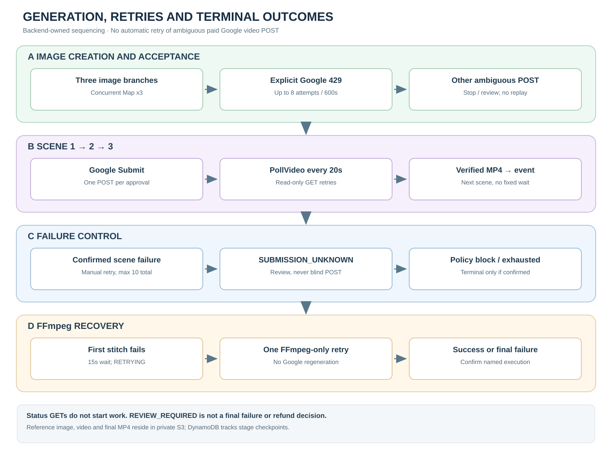

# AFL Video Platform — Current retry, timeout and error-handling contract

**Source reviewed:** 16 November 2026. Authoritative implementations: `src/api/handler.py`, `src/image_worker/{handler.py,google_direct.py}`, `src/google_video_worker/handler.py`, `src/assembly_worker/handler.py`, `src/handoff_watchdog/handler.py`, `frontend/app.js`, and `infrastructure/app/{backend,google-video,assembly,handoff-watchdog}.yaml`. These are **source-configured** values, not independently confirmed effective live AWS/provider limits. Historical guidance superseded: previous sections in this file describing **Scene 2/3 10s/20s waits** or **no FFmpeg retry** were incorrect after recent deployments.

## Non-negotiable safety principles

1. **Google image:** automatically resubmit *only after a definite HTTP 429 rejection*, bounded by time and attempts. Other possibly accepted image POSTs are **not** blindly retried.
2. **Google video:** no Step Functions automatic retry on billable `Submit`; `SUBMISSION_UNKNOWN` is persisted *before* POST. A network failure after submit is potentially charged. Do not infer refund eligibility.
3. **Read-only Google video polling:** may retry transient GET task failures. `PollVideo` retries and its normal 20s polling wait are **not additional paid generation requests**.
4. **Next scene:** advance only on successful verified prior scene completion and expected private S3 MP4, with named Step Functions execution and DynamoDB conditional admission. No fixed 10s/20s inter-scene waits remain.
5. **FFmpeg:** may retry **once** only after a worker-confirmed first failure; never retry ambiguous PROCESSING timeouts. A failed first worker attempt must **not** prematurely terminate a job.
6. **Terminal:** confirmed content block, definitively failed images, exhausted eligible video attempts, exhausted verified FFmpeg retry or verified final MP4. `REVIEW_REQUIRED` and missing workflow evidence are **not** terminal or refund-ready.
7. **Payment:** not implemented. Billing entitlement/refunds must not infer payment status from Google approval, 10 retries, or stage status alone.

## Current source configuration

| Operation | Timeout / cadence | Retry authority and maximum | What happens on failure or uncertainty |
|---|---|---|---|
| API Gateway → API Lambda | API Lambda **15s**, 256 MB; effective API Gateway timeout requires AWS verification | No general application retry | 400 input; 404 absent; 409 conflict; 503 unsafe/disabled handoff; 500 unexpected |
| S3 presign upload | Signed POST **300s validity**; up to 10 MiB JPEG/PNG/WebP | New form may be requested; not an AI call | Does not prove selfie actually uploaded; `POST /jobs` validates object existence/type/size |
| Browser S3 selfie POST | No explicit abort deadline in browser code | On `TypeError` only: initial + **2** retries after **700ms** and **1400ms**; no automatic repeat for explicit non-2xx | May have succeeded despite lost network acknowledgement; verify job before replay |
| `POST /jobs` | API Lambda 15s | Deterministic job ID from idempotency key; matching fingerprint returns existing job | Retry with same key/input is safe in principle; browser does not universally retry ambiguous creation |
| Image workflow | Standard SFN **1800s** total; image worker Lambda **600s**, 1024MB | One SFN name per job. Image scene Map `MaxConcurrency:3` | Failed Prepare/Map/Finalize catches to recovery; stale image reconciler is separate |
| Google reference image POST (each scene) | `urllib` timeout **240s**; image worker 600s | **Explicit HTTP 429 only**: up to **8 total submissions**, within **600s retry window**, `Retry-After` or backoff/jitter; SFN Wait between attempts | 400/401/403/422/5xx, non-429 and ambiguous POST outcomes are **not** automatically resubmitted. `GOOGLE_SUBMISSION_UNKNOWN` requires review |
| Periodic image stale-job reconciliation | EventBridge every **5 minutes** in backend IaC | Dev-only image worker operation `reconcile` scans up to **10 × 100** DDB evaluations; 45-min generation-age threshold; no new provider calls | Marks incomplete scenes terminally failed, preserves completed checkpoints; race/late response testing still required |
| Video Step Functions (each scene) | Standard SFN `TimeoutSeconds:3600`; Google worker Lambda **300s**, 1024MB | Named execution per authorised scene/attempt | Error in/after `Submit` may leave uncertain provider acceptance; no automatic paid resubmit |
| Google video submit | Interactions POST `urlopen(timeout=150)` | **1 model POST per authorised attempt**, no `Submit` retry in ASL. Up to 10 total attempts **only after separately confirmed eligible provider failure** | `PREPARED → SUBMISSION_UNKNOWN` written before provider POST; if returned interaction ID, store `PROCESSING`. Unknown acceptance remains under review |
| Sequential handoff | EventBridge → API verifies DDB result and expected S3 MP4 → reserves next SFN | **No fixed scheduling waits** for Scene 2 or Scene 3. AWS event/task startup takes some time | Missing event or uncertain SFN StartExecution needs watchdog/reconciliation, not another Google POST |
| Google video status GET | `urlopen(timeout=150)` within worker. `WaitForVideo` **20s** between polls | `PollVideo` TaskFailed `Retry: MaxAttempts=3, IntervalSeconds=10, BackoffRate=2` = initial GET + up to **3** more GETs (10/20/40s waits); loop while provider says waiting, bounded by SFN 3600s | Unexpected state or exhausted read failures → AWS review; do **not** create fresh Google interaction |
| Google output to private S3 | Google worker 300s; inline response bounded or optional GCS mode | May read existing interaction/output; not another model POST | S3/DDB failure after provider success requires reconciliation. GCS output mode must be checked against live parameter before claiming enabled |
| Manual real video scene retry | API 15s, new SFN execution; up to **10 total attempts per scene** | Explicit user confirmation + Idempotency-Key; confirmed Google terminal status, old SFN `SUCCEEDED`, unchanged reference source, no existing assembly and attempts remaining | No retry on ambiguous/unknown submission, current execution, or policy block; preserves other scenes and image assets |
| Final FFmpeg assembly | Worker Lambda **600s**, **2048 MB memory**; source-configured ephemeral storage; named SFN `final-{jobId}` | SFN `Stitch` Catch → `WaitBeforeConfirmedRetry` **15s** → **one** `RetryConfirmedAssemblyFailure` task. Worker only admits retry from persisted `FAILED,retryCount=0` | `PROCESSING` timeout uncertain → review, **not** retry. `FAILED` first worker + RUNNING SFN → `STITCHING/RETRYING, terminal=false` |
| Final FFmpeg exhausted retry | Same named SFN; worker sets `retryCount=1` on confirmed second invocation | No third automatic FFmpeg attempt | Only `assembly.FAILED,retryCount=1` **and** named SFN `FAILED` → `STITCHING_FAILED,terminal=true`. Missing/aborted/timed-out/inconsistent SFN → `REVIEW_REQUIRED`, nonterminal |
| FFprobe / FFmpeg subprocess | ffprobe **15s per probe**; clip normalisation **150s per clip**; concat **60s**; other message-overlay operations may have own bounds | No independent model retry; only the bounded assembly-level retry above | Source MP4s remain stored for safe assembly-only recovery |
| Browser status polls | Image/video job polls **5s**, **15s** after error; Developer diagnostics `GET /jobs/{id}` **2s** when open and tab visible | Single-flight read-only polls; browser close pauses UI only | AWS progression continues after image SFN has started, assuming backend events arrive |
| Per-job handoff watchdog | SFN checks each **60s**; Lambda timeout 60s; `TimeoutSeconds:7200` and explicit **7200s** lifetime | Started by image SFN **RUNNING** EventBridge event, one named `watch-{jobId}`; no Google submit permission | Replays only verified completion events / assembly reconciliation. Missing start event, >2h jobs or certain REVIEW paths can strand recovery |

**Important:** these are application/SFN settings. Underlying boto3/credential-library retries, throttling and exact effective deployed AWS limits were **not independently verified**. Do not state “zero retries anywhere”: SDK or EventBridge retries may happen outside the application-level controls. Never give the watchdog permission to blindly submit new paid Google operations.

## Exact state behaviour and customer-facing outcome

| Evidence from persisted job and AWS | Backend presentation | Terminal? | Action |
|---|---|---|---|
| Image `RETRY_WAIT`, confirmed 429 | `IMAGES / RETRYING` | No | SFN waits/backoff, then reissues bounded Google image POST |
| Image worker final `FAILED` or `PARTIAL_SUCCESS` | `REFERENCE_IMAGES_FAILED` | **Yes** | Preserve completed outputs; new job is required |
| Google video `SUBMISSION_UNKNOWN` without confirmed result | Processing or `REVIEW_REQUIRED` | **No** | Reconcile provider/operation; do not resubmit |
| Google video confirmed terminal failure, attempts remaining | Scene `FAILED`, optional manual retry | **No** | Confirm retry only after old workflow safely stopped |
| Google video confirmed content-policy rejection | `CONTENT_BLOCKED` | **Yes** | Stop sequence, no retries or subsequent scenes |
| Google video confirmed failure at attempt 10 | `VIDEO_ATTEMPTS_EXHAUSTED` | **Yes** | Stop; no further paid attempt |
| FFmpeg first durable `FAILED`, named SFN RUNNING | `STITCHING / RETRYING` | **No** | Wait 15s and attempt one safe assembly-only retry |
| FFmpeg retry durable `FAILED,retryCount=1`, named SFN FAILED | `STITCHING_FAILED` | **Yes** | Customer failure screen |
| FFmpeg worker/ASL mismatch, permission error, timeout | `STITCHING / REVIEW_REQUIRED` | **No** | Human-safe reconciliation, no blind rerun |
| Verified assembly `COMPLETED` and expected final key | `COMPLETED` | **Yes** | Final MP4 shown/download signed for 300s |

The source reads `assembly_failure_disposition(job)` using Step Functions `DescribeExecution` when a persisted FFmpeg `FAILED` needs classification. It does not write or start a worker. The customer frontend uses the backend's `terminal` / `outcome` and `failureCode` for permanent failure screens.

## Error classification and reconciliation

- **Safe to retry automatically:** definitely rejected image HTTP 429 (bounded); transient **read-only** provider status GET; one worker-confirmed failed FFmpeg attempt. A safe retry is specific to its *operation*, not blanket “retry the job”.
- **Never automatically replay a potentially billed Google submit:** network timeout after POST, lost response/interaction ID, unknown workflow status, unknown processing outcome, duplicate EventBridge delivery. Inspect existing operation/status and preserved S3/DynamoDB evidence first.
- **Safe to start a new paid scene attempt only with explicit confirmation and proven provider terminal failure:** earlier SFN finished safely; exactly same reference image; no active assembly; attempts remaining.
- **Operational review is distinct from terminal failure:** `REVIEW_REQUIRED` is not a Stripe refund trigger, not success, and not an instruction for customers to retry the original request.
- **DynamoDB condition failures:** typically signal competing owner/race rather than “try a new paid POST.” Re-read and reconcile named execution.
- **Final media:** S3 signed URL expiry is not loss of stored video. There is no verified, job-aware cleanup of `videos/` today; `uploads/` and `results/` have seven-day lifecycle rules and job DDB TTL is seven days.

## Known weaknesses / outstanding evidence

1. **Watchdog start gap and two-hour cap:** no guaranteed recovery of missed image start event or very long jobs (RA-02).
2. **Provider acceptance ambiguity:** some Google POST responses may be lost without a provider ID, preventing automated settlement (RA-03).
3. **Terminal race admission:** read-then-write paid-scene admission doesn't fence every possible concurrent terminal change (RA-04).
4. **Customer recovery/payment ledger missing:** no customer-scoped anonymous entitlement or persisted Stripe state (RA-05).
5. **Retention/cleanup missing:** no `videos/` lifecycle and seven-day DDB job TTL may remove needed records (RA-06).
6. **Fault-injection/live drift:** confirm first-fail→successful FFmpeg retry, exhausted retry, response loss, duplicate EventBridge, expired MP4 URL and late image write without additional paid Google POST.
7. **Provider quotas:** a global concurrency/rate policy still needs production verification; removing scene-to-scene fixed waits does not change provider-wide quota.
8. **Observability:** error codes and logs exist but a durable operator review queue, alerts and payment-ready reconciliation need further design.

See [RESILIENCE_AUDIT_2026-11-16.md](RESILIENCE_AUDIT_2026-11-16.md) for RA-01…RA-12, [JOB_STATUSES.md](JOB_STATUSES.md) for status meanings, and [API_ENDPOINTS.md](API_ENDPOINTS.md) for the complete route inventory. **No provider API call, live fault test or CloudFormation change was made by this documentation review.**

## EventBridge and application-level failure acknowledgement

An AWS completion event has two separate opportunities to fail:

1. **Target delivery/invocation failure:** EventBridge may retry the target according to each rule's `RetryPolicy`; source-defined maximum ages/attempts are detailed in [EVENT_DRIVEN_ARCHITECTURE.md](EVENT_DRIVEN_ARCHITECTURE.md).
2. **Application-level handoff uncertainty:** `video_sequence_event` can **return** `NEXT_SCENE_HANDOFF_NEEDS_REVIEW` or `ASSEMBLY_HANDOFF_NEEDS_REVIEW` as an ordinary successful Lambda result after a missing/unknown next execution. EventBridge sees a successful invocation; its target-delivery retry may **not** be activated. The per-job watchdog may replay a verified past event after 120s, but can be absent, stopped or past its 2-hour limit.

Neither failure type justifies a new Google POST. A durable needs-review record, alerting and recovery strategy remain **proposed**, not implemented. This distinction should be in every event-driven fault-injection test plan.

**High-priority source issue:** the Google video Step Functions `Claim` task's committed template uses `requestId.$:"$.Execution.Name"`; subsequent tasks use context `"$$.Execution.Name"`. This inconsistency must be tested against the live state machine and corrected via a guarded, separate infrastructure release. It is **not fixed by changing documentation**.

